# Market Intelligence & Curriculum Gap Analyzer — Complete Architecture

> **For beginners:** This document is your blueprint. Read it section by section.
> Each section tells you WHAT to build, WHY it matters, and HOW to build it.
> Follow the Day-by-Day plan at the end to complete in 1 week.

---

## Table of Contents

1. [Executive Architecture](#1-executive-architecture)
2. [System Context Diagram](#2-system-context-diagram)
3. [End-to-End Workflow](#3-end-to-end-workflow)
4. [Agent 1 — Digest Agent](#4-agent-1--digest-agent)
5. [Agent 2 — Gap Analyzer Agent](#5-agent-2--gap-analyzer-agent)
6. [Curriculum Knowledge Graph](#6-curriculum-knowledge-graph)
7. [Retrieval Architecture](#7-retrieval-architecture)
8. [Severity Engine](#8-severity-engine)
9. [When-To-Act Engine](#9-when-to-act-engine)
10. [Feedback Learning System](#10-feedback-learning-system)
11. [Skill Evolution System](#11-skill-evolution-system)
12. [LangGraph Architecture](#12-langgraph-architecture)
13. [Database Schema](#13-database-schema)
14. [Cost Tracking Architecture](#14-cost-tracking-architecture)
15. [Langfuse Architecture](#15-langfuse-architecture)
16. [Promptfoo Evaluation Architecture](#16-promptfoo-evaluation-architecture)
17. [FastAPI Design](#17-fastapi-design)
18. [Frontend Design](#18-frontend-design)
19. [Security Architecture](#19-security-architecture)
20. [Deployment Architecture](#20-deployment-architecture)
21. [MVP Roadmap (1-Week)](#21-mvp-roadmap)
22. [Production Scaling Roadmap](#22-production-scaling-roadmap)
23. [Repository Structure](#23-repository-structure)

---

## 1. Executive Architecture

### What This System Does (Plain English)

Imagine you have 100+ URLs about React, Node.js, Tailwind, etc. This system:

1. **Reads those URLs** → extracts what changed (new versions, deprecations, trends)
2. **Creates a summary (digest)** → structured data about each market signal
3. **A human reviews** → approves or rejects each digest
4. **Compares against your curriculum** → finds what's missing or outdated
5. **Generates gap reports** → "React 19 released, your curriculum teaches React 18"
6. **Another human reviews** → approves or rejects each gap
7. **Learns from feedback** → improves its prompts over time

### Architecture Principles

| Principle | Decision | Why |
|-----------|----------|-----|
| **Two agents only** | Digest Agent + Gap Analyzer | Constraint from requirements |
| **Human-in-the-loop** | No auto-changes to curriculum | Safety — humans approve everything |
| **Incremental processing** | URL → Digest → Gap (pipeline) | Each stage is independently testable |
| **Evidence-based** | Every gap must cite sources | No hallucinated recommendations |
| **Cost-aware** | Track tokens/cost per node | Budget control |
| **Feedback-driven** | Learn from reviewer decisions | Continuous improvement |

### Technology Decisions

| Layer | Technology | Why This One |
|-------|-----------|-------------|
| Orchestration | **LangGraph** | Built for stateful AI workflows with human checkpoints |
| Backend | **FastAPI** | Async Python, great for AI workloads |
| Database | **Supabase (PostgreSQL)** | Free tier, built-in auth, real-time |
| Vector Search | **pgvector** | Lives in same Postgres — no extra infra |
| Knowledge Graph | **PostgreSQL with graph tables** (not Neo4j) | See [Section 6] — simpler for beginners, sufficient for our scale |
| Frontend | **React + Vite** | Fast dev, modern tooling |
| LLM | **Claude (primary)** + OpenAI (fallback) | Claude for quality, OpenAI as backup |
| Content Extraction | **Firecrawl** | Best API for web scraping, handles JS rendering |
| Observability | **Langfuse** | Open-source, LangGraph integration |
| Evaluation | **Promptfoo** | CLI-based, easy to set up |
| Deployment | **Docker + Cloud Run** | Simplest production path |

### High-Level Architecture Diagram

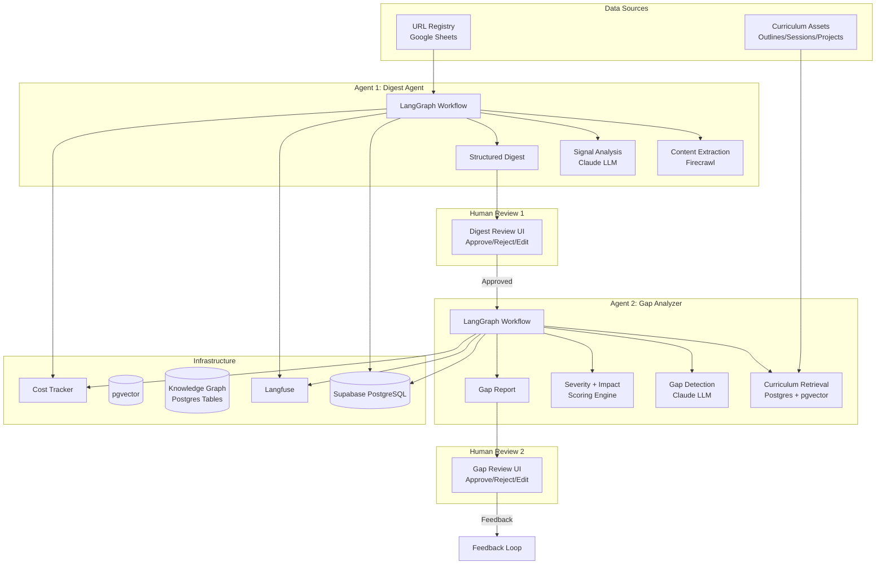

---

## 2. System Context Diagram

> **For beginners:** This shows WHO interacts with the system and HOW.

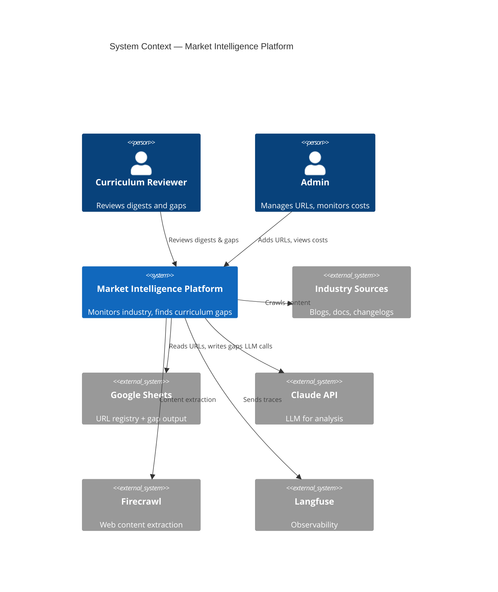

---

## 3. End-to-End Workflow

### The Complete Pipeline

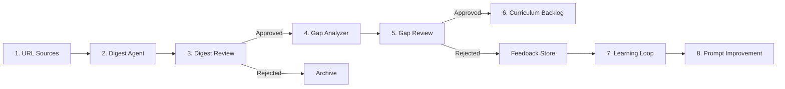

### Detailed Flow (Step by Step)

```
STEP 1: URL Intake
├── Read URL registry from Google Sheets
├── Deduplicate against already-processed URLs
├── Validate URL accessibility
└── Queue for processing

STEP 2: Digest Agent (Agent 1)
├── Extract content via Firecrawl
├── If extraction fails → mark as FAILED, stop
├── Check source credibility
├── Generate structured digest via Claude
├── Extract tools, versions, signals
├── Classify relevance to curriculum
└── Save digest with status=PENDING

STEP 3: Human Review (Digests)
├── Reviewer sees digest in UI
├── Options: Approve | Reject | Edit | Needs Review
├── All actions logged with timestamp + reviewer
└── Only APPROVED digests proceed

STEP 4: Gap Analyzer (Agent 2)
├── Fetch approved digests
├── Retrieve relevant curriculum (Postgres + pgvector + Graph)
├── Generate gap candidates
├── Classify each gap (type)
├── Score severity
├── Analyze impact
├── Calculate when-to-act
├── Run critic validation
└── Save gaps with status=PENDING

STEP 5: Human Review (Gaps)
├── Reviewer sees gap report
├── Options: Approve | Reject | Edit | Add Feedback
├── All actions logged
└── Approved gaps → curriculum backlog

STEP 6: Feedback Loop
├── Collect reviewer feedback
├── Analyze rejection patterns
├── Suggest prompt improvements
├── Validate with Promptfoo
├── Human approves prompt changes
└── Deploy new prompt versions
```

---

## 4. Agent 1 — Digest Agent

> **For beginners:** This agent takes a URL and produces a structured summary.
> Think of it as a smart reader that extracts key information.

### LangGraph State

```python
# What "state" means: it's the data that flows through the agent.
# Each node reads from state, does work, and writes back to state.

from typing import TypedDict, Optional, Literal
from datetime import datetime

class DigestState(TypedDict):
    # Input
    url: str
    url_id: str

    # Content Extraction
    raw_content: Optional[str]
    extraction_status: Literal["pending", "success", "failed"]
    extraction_error: Optional[str]

    # Source Analysis
    source_title: Optional[str]
    source_type: Optional[str]  # blog, docs, changelog, tutorial, etc.
    credibility_score: Optional[float]  # 0.0 to 1.0

    # Digest Output
    digest_id: Optional[str]
    topic: Optional[str]
    summary: Optional[str]
    market_signal: Optional[str]
    evidence_snippet: Optional[str]

    # Tools & Versions
    tools_versions: Optional[list[dict]]  # [{tool: "React", version: "19", change_type: "major"}]

    # Classification
    relevance_score: Optional[float]  # 0.0 to 1.0
    relevance_reason: Optional[str]
    confidence: Optional[float]

    # Status
    status: Literal["pending", "extracted", "generated", "approved", "rejected"]

    # Cost tracking
    total_tokens: int
    total_cost: float

    # Error handling
    errors: list[str]
    retry_count: int
```

### LangGraph Graph Design

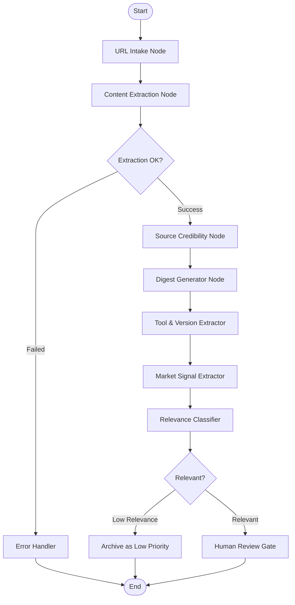

### Node Implementations

#### Node 1: URL Intake

```python
# What this does: validates the URL and checks if we already processed it

async def url_intake_node(state: DigestState) -> DigestState:
    """Validate URL and check for duplicates."""
    url = state["url"]

    # Check if URL already processed
    existing = await supabase.table("market_digests") \
        .select("digest_id") \
        .eq("url", url) \
        .execute()

    if existing.data:
        return {**state, "status": "duplicate", "errors": ["URL already processed"]}

    # Basic URL validation
    if not url.startswith(("http://", "https://")):
        return {**state, "status": "failed", "errors": ["Invalid URL format"]}

    return {**state, "status": "pending"}
```

#### Node 2: Content Extraction

```python
# What this does: uses Firecrawl to read the webpage and get clean text

from firecrawl import FirecrawlApp

async def content_extraction_node(state: DigestState) -> DigestState:
    """Extract content from URL using Firecrawl."""
    firecrawl = FirecrawlApp(api_key=settings.FIRECRAWL_API_KEY)

    try:
        result = firecrawl.scrape_url(
            state["url"],
            params={
                "formats": ["markdown"],
                "onlyMainContent": True,
                "waitFor": 3000,
            }
        )

        if not result or not result.get("markdown"):
            return {
                **state,
                "extraction_status": "failed",
                "extraction_error": "No content extracted",
                "errors": state["errors"] + ["Extraction returned empty"],
            }

        return {
            **state,
            "raw_content": result["markdown"][:15000],  # Cap at 15k chars
            "source_title": result.get("metadata", {}).get("title", ""),
            "extraction_status": "success",
            "status": "extracted",
        }

    except Exception as e:
        # Playwright fallback
        try:
            content = await playwright_extract(state["url"])
            return {
                **state,
                "raw_content": content[:15000],
                "extraction_status": "success",
                "status": "extracted",
            }
        except Exception as e2:
            return {
                **state,
                "extraction_status": "failed",
                "extraction_error": str(e2),
                "errors": state["errors"] + [f"Both extractors failed: {e}, {e2}"],
            }
```

#### Node 3: Source Credibility Check

```python
# What this does: scores how trustworthy the source is
# Official docs score higher than random blogs

CREDIBILITY_RULES = {
    "official_docs": 0.95,    # reactjs.org, vuejs.org, etc.
    "major_blog": 0.85,       # vercel.com/blog, blog.github.com
    "tech_publication": 0.80, # dev.to (verified), smashingmagazine
    "personal_blog": 0.60,    # individual developer blogs
    "social_media": 0.40,     # twitter threads, reddit posts
    "unknown": 0.50,
}

async def source_credibility_node(state: DigestState) -> DigestState:
    """Assess source credibility based on domain and content quality."""
    from urllib.parse import urlparse

    domain = urlparse(state["url"]).netloc.lower()

    # Check against known trusted domains
    trusted_domains = await supabase.table("url_registry") \
        .select("domain, credibility_tier") \
        .execute()

    tier = "unknown"
    for entry in trusted_domains.data:
        if entry["domain"] in domain:
            tier = entry["credibility_tier"]
            break

    score = CREDIBILITY_RULES.get(tier, 0.50)

    return {
        **state,
        "source_type": tier,
        "credibility_score": score,
    }
```

#### Node 4: Digest Generator

```python
# What this does: sends content to Claude and asks it to create a structured summary
# This is where the LLM does its main work

from langchain_anthropic import ChatAnthropic
from langchain_core.prompts import ChatPromptTemplate

DIGEST_PROMPT = ChatPromptTemplate.from_messages([
    ("system", """You are a market intelligence analyst for an ed-tech curriculum team.

Analyze the provided content and extract a structured digest.

Focus on:
1. What changed or was announced
2. Which tools/frameworks/versions are mentioned
3. What the market signal is (trend, deprecation, new release, best practice change)
4. Key evidence quotes from the source

Be factual. Only include information present in the source content.
Do NOT speculate or add information not in the source.

Respond in this exact JSON format:
{{
    "topic": "main topic",
    "summary": "2-3 sentence summary of key changes",
    "market_signal": "one of: new_release | deprecation | best_practice_change | security_update | performance_improvement | breaking_change | new_tool | trend_shift",
    "evidence_snippet": "exact quote from source that supports the signal (max 200 chars)",
    "tools_versions": [
        {{"tool": "name", "version": "x.y", "change_type": "major|minor|patch|deprecation"}}
    ],
    "confidence": 0.0-1.0
}}"""),
    ("human", """Source URL: {url}
Source Title: {source_title}

Content:
{content}"""),
])

async def digest_generator_node(state: DigestState) -> DigestState:
    """Generate structured digest using Claude."""
    llm = ChatAnthropic(
        model="claude-sonnet-4-20250514",
        temperature=0,
        max_tokens=2000,
    )

    # Track tokens via callback
    with get_langfuse_callback() as cb:
        response = await llm.ainvoke(
            DIGEST_PROMPT.format_messages(
                url=state["url"],
                source_title=state["source_title"],
                content=state["raw_content"],
            ),
            config={"callbacks": [cb]},
        )

    parsed = json.loads(response.content)

    return {
        **state,
        "topic": parsed["topic"],
        "summary": parsed["summary"],
        "market_signal": parsed["market_signal"],
        "evidence_snippet": parsed["evidence_snippet"],
        "tools_versions": parsed["tools_versions"],
        "confidence": parsed["confidence"],
        "status": "generated",
        "total_tokens": state["total_tokens"] + cb.total_tokens,
        "total_cost": state["total_cost"] + cb.total_cost,
    }
```

#### Node 5: Tool & Version Extractor

```python
# What this does: specifically extracts tool names and versions
# This is a separate focused pass to catch things the digest might miss

TOOL_EXTRACTION_PROMPT = """Extract ALL tools, frameworks, libraries, and their versions mentioned in this content.

For each, identify:
- tool name (canonical name, e.g., "React" not "react.js")
- version (if mentioned)
- change_type: major | minor | patch | deprecation | new

Content:
{content}

Return JSON array:
[{{"tool": "...", "version": "...", "change_type": "..."}}]

If no tools/versions found, return empty array: []"""

async def tool_version_extractor_node(state: DigestState) -> DigestState:
    """Dedicated tool/version extraction for completeness."""
    llm = ChatAnthropic(model="claude-sonnet-4-20250514", temperature=0)

    response = await llm.ainvoke(
        TOOL_EXTRACTION_PROMPT.format(content=state["raw_content"][:8000])
    )

    extracted = json.loads(response.content)

    # Merge with existing tools_versions (deduplicate)
    existing = {t["tool"]: t for t in (state.get("tools_versions") or [])}
    for tool in extracted:
        if tool["tool"] not in existing:
            existing[tool["tool"]] = tool

    return {
        **state,
        "tools_versions": list(existing.values()),
    }
```

#### Node 6: Market Signal Extractor

```python
# What this does: classifies what kind of market signal this is
# and how significant it is for curriculum

SIGNAL_PROMPT = """Analyze this market digest and classify the signal.

Digest:
Topic: {topic}
Summary: {summary}
Tools: {tools}

Classify:
1. signal_type: new_release | deprecation | breaking_change | best_practice_change | security_update | new_tool | trend_shift | performance_improvement
2. signal_strength: strong | moderate | weak
3. curriculum_relevance: high | medium | low | none
4. reasoning: why this matters for a web development curriculum

Return JSON:
{{"signal_type": "...", "signal_strength": "...", "curriculum_relevance": "...", "reasoning": "..."}}"""

async def market_signal_extractor_node(state: DigestState) -> DigestState:
    """Classify and strengthen market signal analysis."""
    llm = ChatAnthropic(model="claude-sonnet-4-20250514", temperature=0)

    response = await llm.ainvoke(
        SIGNAL_PROMPT.format(
            topic=state["topic"],
            summary=state["summary"],
            tools=json.dumps(state["tools_versions"]),
        )
    )

    signal = json.loads(response.content)
    state["market_signal"] = signal["signal_type"]

    return state
```

#### Node 7: Relevance Classifier

```python
# What this does: decides if this digest is relevant to YOUR curriculum
# Filters out noise (e.g., a Rust update when you teach JavaScript)

RELEVANCE_PROMPT = """You are evaluating whether a market signal is relevant to a web development curriculum.

The curriculum covers:
- HTML, CSS, JavaScript
- React, Node.js, Express
- Python, SQL, MongoDB
- Git, Docker, AWS basics
- Testing (Jest, Cypress)
- Build tools (Vite, Webpack)
- CSS frameworks (Tailwind, Bootstrap)
- State management (Redux, Context API)

Market Signal:
Topic: {topic}
Summary: {summary}
Tools: {tools}

Rate relevance from 0.0 (not relevant) to 1.0 (highly relevant).

Return JSON:
{{"relevance_score": 0.0-1.0, "relevance_reason": "why this is/isn't relevant"}}"""

async def relevance_classifier_node(state: DigestState) -> DigestState:
    """Classify relevance to curriculum."""
    llm = ChatAnthropic(model="claude-sonnet-4-20250514", temperature=0)

    response = await llm.ainvoke(
        RELEVANCE_PROMPT.format(
            topic=state["topic"],
            summary=state["summary"],
            tools=json.dumps(state["tools_versions"]),
        )
    )

    result = json.loads(response.content)

    return {
        **state,
        "relevance_score": result["relevance_score"],
        "relevance_reason": result["relevance_reason"],
    }
```

#### Node 8: Conditional Routing

```python
# What this does: decides what happens next based on the data
# This is LangGraph's way of doing if/else in workflows

def route_after_extraction(state: DigestState) -> str:
    """Route based on extraction result."""
    if state["extraction_status"] == "failed":
        return "handle_error"
    return "credibility_check"

def route_after_relevance(state: DigestState) -> str:
    """Route based on relevance score."""
    if state["relevance_score"] < 0.3:
        return "archive"
    return "review_gate"
```

#### Node 9: Review Gate (Human-in-the-Loop)

```python
# What this does: PAUSES the workflow and waits for a human to review
# This is a critical LangGraph feature — interrupt() stops execution

from langgraph.types import interrupt, Command

async def digest_review_gate(state: DigestState) -> DigestState:
    """Pause for human review. Resume with approved/rejected."""

    # Save digest to database for review UI
    await supabase.table("market_digests").insert({
        "digest_id": state["digest_id"],
        "url": state["url"],
        "source_title": state["source_title"],
        "source_type": state["source_type"],
        "topic": state["topic"],
        "summary": state["summary"],
        "market_signal": state["market_signal"],
        "evidence_snippet": state["evidence_snippet"],
        "tools_versions": state["tools_versions"],
        "relevance_score": state["relevance_score"],
        "confidence": state["confidence"],
        "status": "pending_review",
    }).execute()

    # This STOPS the workflow until a human responds
    review_decision = interrupt({
        "type": "digest_review",
        "digest_id": state["digest_id"],
        "message": "Please review this digest",
    })

    # Human response comes back here
    return {
        **state,
        "status": review_decision["decision"],  # approved / rejected
    }
```

### Complete Digest Agent Graph Assembly

```python
from langgraph.graph import StateGraph, START, END

def build_digest_agent() -> StateGraph:
    """Assemble the complete Digest Agent graph."""

    graph = StateGraph(DigestState)

    # Add all nodes
    graph.add_node("url_intake", url_intake_node)
    graph.add_node("extract_content", content_extraction_node)
    graph.add_node("credibility_check", source_credibility_node)
    graph.add_node("generate_digest", digest_generator_node)
    graph.add_node("extract_tools", tool_version_extractor_node)
    graph.add_node("extract_signals", market_signal_extractor_node)
    graph.add_node("classify_relevance", relevance_classifier_node)
    graph.add_node("review_gate", digest_review_gate)
    graph.add_node("handle_error", error_handler_node)
    graph.add_node("archive", archive_node)

    # Define edges (the flow)
    graph.add_edge(START, "url_intake")
    graph.add_edge("url_intake", "extract_content")

    # Conditional: did extraction work?
    graph.add_conditional_edges(
        "extract_content",
        route_after_extraction,
        {
            "handle_error": "handle_error",
            "credibility_check": "credibility_check",
        }
    )

    graph.add_edge("credibility_check", "generate_digest")
    graph.add_edge("generate_digest", "extract_tools")
    graph.add_edge("extract_tools", "extract_signals")
    graph.add_edge("extract_signals", "classify_relevance")

    # Conditional: is it relevant?
    graph.add_conditional_edges(
        "classify_relevance",
        route_after_relevance,
        {
            "archive": "archive",
            "review_gate": "review_gate",
        }
    )

    graph.add_edge("review_gate", END)
    graph.add_edge("handle_error", END)
    graph.add_edge("archive", END)

    return graph.compile(
        checkpointer=PostgresSaver(connection_string=settings.DATABASE_URL),
        interrupt_before=["review_gate"],
    )
```

---

## 5. Agent 2 — Gap Analyzer Agent

> **For beginners:** This agent takes approved digests and compares them against
> your existing curriculum to find what's missing or outdated.

### LangGraph State

```python
class GapAnalyzerState(TypedDict):
    # Input
    digest_id: str
    digest: dict  # The approved digest

    # Curriculum retrieval results
    relevant_sessions: list[dict]
    relevant_projects: list[dict]
    relevant_assessments: list[dict]
    relevant_quizzes: list[dict]
    relevant_tools: list[dict]
    graph_context: list[dict]  # From knowledge graph

    # Gap detection
    gap_candidates: list[dict]

    # Classified gaps
    classified_gaps: list[dict]  # Each has gap_type

    # Scored gaps
    scored_gaps: list[dict]  # Each has severity + impact

    # Final gaps with when-to-act
    final_gaps: list[dict]

    # Critic validation
    validated_gaps: list[dict]
    critic_feedback: list[str]

    # Status
    status: str
    total_tokens: int
    total_cost: float
    errors: list[str]
```

### LangGraph Graph Design

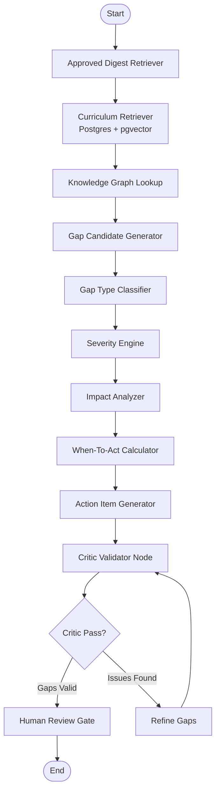

### Key Node Implementations

#### Node 1: Approved Digest Retriever

```python
async def approved_digest_retriever(state: GapAnalyzerState) -> GapAnalyzerState:
    """Fetch approved digest details."""
    result = await supabase.table("market_digests") \
        .select("*") \
        .eq("digest_id", state["digest_id"]) \
        .eq("status", "approved") \
        .single() \
        .execute()

    if not result.data:
        return {**state, "status": "error", "errors": ["Digest not found or not approved"]}

    return {**state, "digest": result.data}
```

#### Node 2: Curriculum Retriever (Hybrid)

```python
# What this does: finds relevant curriculum content using THREE methods:
# 1. Keyword search (exact matches in Postgres)
# 2. Semantic search (meaning-based search using pgvector)
# 3. Graph search (relationship-based search)

async def curriculum_retriever_node(state: GapAnalyzerState) -> GapAnalyzerState:
    """Hybrid retrieval: structured + semantic + graph."""
    digest = state["digest"]
    tools = [t["tool"] for t in digest.get("tools_versions", [])]
    topic = digest.get("topic", "")

    # 1. STRUCTURED RETRIEVAL: exact tool/version matches
    sessions_by_tool = await supabase.table("curriculum_documents") \
        .select("*") \
        .or_(",".join([f"tools.cs.{{{t}}}" for t in tools])) \
        .execute()

    # 2. SEMANTIC RETRIEVAL: find similar content by meaning
    # Generate embedding for the digest summary
    embedding = await generate_embedding(digest["summary"])

    semantic_results = await supabase.rpc(
        "match_curriculum_documents",
        {
            "query_embedding": embedding,
            "match_threshold": 0.7,
            "match_count": 20,
        }
    ).execute()

    # 3. GRAPH RETRIEVAL: find connected curriculum items
    graph_results = await query_curriculum_graph(tools, topic)

    return {
        **state,
        "relevant_sessions": merge_and_dedupe(
            sessions_by_tool.data,
            semantic_results.data,
        ),
        "relevant_projects": extract_projects(semantic_results.data),
        "relevant_assessments": extract_assessments(semantic_results.data),
        "relevant_quizzes": extract_quizzes(semantic_results.data),
        "relevant_tools": extract_tools(sessions_by_tool.data),
        "graph_context": graph_results,
    }
```

#### Node 3: Gap Candidate Generator

```python
GAP_DETECTION_PROMPT = """You are a curriculum gap analyzer.

Compare this market signal against the existing curriculum content.

MARKET SIGNAL:
Topic: {topic}
Summary: {summary}
Signal Type: {signal_type}
Tools/Versions: {tools}
Evidence: {evidence}

EXISTING CURRICULUM:
Sessions: {sessions}
Projects: {projects}
Assessments: {assessments}
Quizzes: {quizzes}
Current Tools: {current_tools}

IDENTIFY GAPS:
For each gap found, provide:
1. gap_statement: What is missing or outdated (specific)
2. what_to_act: What specific action should be taken
3. why_to_act: Why this matters (evidence-based)
4. curriculum_evidence: What exists now that needs updating
5. gap_type: One of: design_gap | tool_gap | version_gap | practice_gap | project_gap | assessment_gap | quiz_gap | documentation_gap

RULES:
- Only identify gaps supported by evidence
- If curriculum already covers the topic adequately, say "no gap found"
- Be specific about WHICH sessions/projects/assessments are affected
- Do NOT suggest gaps for tools/topics outside the curriculum scope

Return JSON:
{{"gaps": [{{"gap_statement": "...", "what_to_act": "...", "why_to_act": "...", "curriculum_evidence": "...", "gap_type": "..."}}], "no_gap_reason": "..." if no gaps}}"""

async def gap_candidate_generator_node(state: GapAnalyzerState) -> GapAnalyzerState:
    """Generate gap candidates using LLM comparison."""
    llm = ChatAnthropic(model="claude-sonnet-4-20250514", temperature=0, max_tokens=4000)

    response = await llm.ainvoke(
        GAP_DETECTION_PROMPT.format(
            topic=state["digest"]["topic"],
            summary=state["digest"]["summary"],
            signal_type=state["digest"]["market_signal"],
            tools=json.dumps(state["digest"]["tools_versions"]),
            evidence=state["digest"]["evidence_snippet"],
            sessions=json.dumps(state["relevant_sessions"][:10]),
            projects=json.dumps(state["relevant_projects"][:10]),
            assessments=json.dumps(state["relevant_assessments"][:10]),
            quizzes=json.dumps(state["relevant_quizzes"][:10]),
            current_tools=json.dumps(state["relevant_tools"][:10]),
        )
    )

    result = json.loads(response.content)

    if not result.get("gaps"):
        return {**state, "gap_candidates": [], "status": "no_gaps_found"}

    return {**state, "gap_candidates": result["gaps"]}
```

#### Node 4: Gap Type Classifier

```python
GAP_TYPES = {
    "design_gap": "Curriculum design or structure needs updating",
    "tool_gap": "New tool should be added or existing tool replaced",
    "version_gap": "Tool/framework version needs updating",
    "practice_gap": "Best practices have changed",
    "project_gap": "Projects need updating or new projects needed",
    "assessment_gap": "Assessments don't cover new concepts",
    "quiz_gap": "Quiz questions are outdated or missing",
    "documentation_gap": "Documentation references are outdated",
}

async def gap_type_classifier_node(state: GapAnalyzerState) -> GapAnalyzerState:
    """Classify each gap into a specific type."""
    classified = []
    for gap in state["gap_candidates"]:
        # LLM already classified in gap generation, but we validate
        gap_type = gap.get("gap_type", "design_gap")
        if gap_type not in GAP_TYPES:
            gap_type = "design_gap"
        gap["gap_type"] = gap_type
        gap["gap_type_description"] = GAP_TYPES[gap_type]
        classified.append(gap)

    return {**state, "classified_gaps": classified}
```

#### Node 5: Severity Engine

```python
# Detailed in Section 8
async def severity_engine_node(state: GapAnalyzerState) -> GapAnalyzerState:
    """Score severity for each gap."""
    scored = []
    for gap in state["classified_gaps"]:
        severity = await calculate_severity(gap, state)
        gap["severity"] = severity["level"]
        gap["severity_score"] = severity["score"]
        gap["severity_factors"] = severity["factors"]
        scored.append(gap)

    return {**state, "scored_gaps": scored}
```

#### Node 6: Impact Analyzer

```python
IMPACT_PROMPT = """Given this curriculum gap, identify ALL impacted curriculum items.

Gap: {gap_statement}
Gap Type: {gap_type}
Tools: {tools}

Curriculum Context:
Sessions: {sessions}
Projects: {projects}
Assessments: {assessments}
Quizzes: {quizzes}

Return JSON:
{{
    "impacted_courses": ["course names"],
    "impacted_sessions": ["session IDs or names"],
    "impacted_projects": ["project names"],
    "impacted_assessments": ["assessment names"],
    "impacted_quizzes": ["quiz IDs or names"],
    "impacted_tools": ["tool names"],
    "impact_summary": "one sentence describing total impact"
}}"""

async def impact_analyzer_node(state: GapAnalyzerState) -> GapAnalyzerState:
    """Analyze impact of each gap across curriculum."""
    llm = ChatAnthropic(model="claude-sonnet-4-20250514", temperature=0)

    for gap in state["scored_gaps"]:
        response = await llm.ainvoke(
            IMPACT_PROMPT.format(
                gap_statement=gap["gap_statement"],
                gap_type=gap["gap_type"],
                tools=json.dumps(state["digest"]["tools_versions"]),
                sessions=json.dumps(state["relevant_sessions"][:10]),
                projects=json.dumps(state["relevant_projects"][:10]),
                assessments=json.dumps(state["relevant_assessments"][:10]),
                quizzes=json.dumps(state["relevant_quizzes"][:10]),
            )
        )
        impact = json.loads(response.content)
        gap.update(impact)

    return {**state, "scored_gaps": state["scored_gaps"]}
```

#### Node 7: When-To-Act Calculator

```python
# Detailed in Section 9
async def when_to_act_node(state: GapAnalyzerState) -> GapAnalyzerState:
    """Calculate action deadlines for each gap."""
    for gap in state["scored_gaps"]:
        when = calculate_when_to_act(gap)
        gap["when_to_act"] = when["date"]
        gap["when_to_act_rationale"] = when["rationale"]

    return {**state, "final_gaps": state["scored_gaps"]}
```

#### Node 8: Action Item Generator

```python
ACTION_PROMPT = """Generate specific, actionable items for this curriculum gap.

Gap: {gap_statement}
Type: {gap_type}
Severity: {severity}
Impacted: {impacted}

Generate 1-3 concrete action items. Each should be:
- Specific (not vague)
- Assignable (someone can own it)
- Measurable (you can tell when it's done)

Return JSON:
{{"actions": [{{"action": "...", "owner_type": "content_author|reviewer|tech_lead", "effort": "small|medium|large", "priority": "P0|P1|P2|P3"}}]}}"""

async def action_item_generator_node(state: GapAnalyzerState) -> GapAnalyzerState:
    """Generate specific action items for each gap."""
    llm = ChatAnthropic(model="claude-sonnet-4-20250514", temperature=0)

    for gap in state["final_gaps"]:
        response = await llm.ainvoke(
            ACTION_PROMPT.format(
                gap_statement=gap["gap_statement"],
                gap_type=gap["gap_type"],
                severity=gap["severity"],
                impacted=json.dumps({
                    "courses": gap.get("impacted_courses", []),
                    "sessions": gap.get("impacted_sessions", []),
                }),
            )
        )
        actions = json.loads(response.content)
        gap["action_items"] = actions["actions"]

    return state
```

#### Node 9: Critic Validator

```python
# What this does: a SECOND LLM call that tries to DISPROVE each gap
# This catches hallucinations and false positives

CRITIC_PROMPT = """You are a critic reviewing curriculum gap findings.

Your job is to CHALLENGE each gap. Look for:
1. Is the gap real? Does the evidence support it?
2. Is the severity appropriate? Over-inflated?
3. Is the action item practical?
4. Could this be a false positive?

Gap to review:
{gap}

Curriculum evidence provided:
{evidence}

Return JSON:
{{
    "is_valid": true/false,
    "confidence": 0.0-1.0,
    "issues": ["list of problems found"],
    "suggestions": ["improvements if valid"],
    "revised_severity": "critical|high|medium|low" or null if unchanged
}}"""

async def critic_validator_node(state: GapAnalyzerState) -> GapAnalyzerState:
    """Critically validate each gap finding."""
    llm = ChatAnthropic(model="claude-sonnet-4-20250514", temperature=0.1)

    validated = []
    feedback = []

    for gap in state["final_gaps"]:
        response = await llm.ainvoke(
            CRITIC_PROMPT.format(
                gap=json.dumps(gap),
                evidence=json.dumps({
                    "sessions": state["relevant_sessions"][:5],
                    "tools": state["relevant_tools"][:5],
                }),
            )
        )

        critique = json.loads(response.content)

        if critique["is_valid"]:
            gap["critic_feedback"] = critique.get("suggestions", [])
            if critique.get("revised_severity"):
                gap["severity"] = critique["revised_severity"]
            gap["critic_confidence"] = critique["confidence"]
            validated.append(gap)
        else:
            feedback.append(f"Rejected gap: {gap['gap_statement']} - {critique['issues']}")

    return {
        **state,
        "validated_gaps": validated,
        "critic_feedback": feedback,
    }
```

#### Node 10: Human Review Gate

```python
async def gap_review_gate(state: GapAnalyzerState) -> GapAnalyzerState:
    """Save gaps and pause for human review."""

    # Save each validated gap
    for gap in state["validated_gaps"]:
        gap_record = {
            "gap_id": generate_uuid(),
            "digest_id": state["digest_id"],
            "gap_type": gap["gap_type"],
            "market_signal": state["digest"]["market_signal"],
            "curriculum_evidence": gap["curriculum_evidence"],
            "gap_statement": gap["gap_statement"],
            "what_to_act": gap["what_to_act"],
            "why_to_act": gap["why_to_act"],
            "when_to_act": gap["when_to_act"],
            "severity": gap["severity"],
            "impacted_courses": gap.get("impacted_courses", []),
            "impacted_sessions": gap.get("impacted_sessions", []),
            "impacted_projects": gap.get("impacted_projects", []),
            "impacted_assessments": gap.get("impacted_assessments", []),
            "impacted_quizzes": gap.get("impacted_quizzes", []),
            "impacted_tools": gap.get("impacted_tools", []),
            "action_items": gap.get("action_items", []),
            "confidence": gap.get("critic_confidence", 0.5),
            "critic_feedback": gap.get("critic_feedback", []),
            "decision_status": "pending_review",
        }
        await supabase.table("curriculum_gaps").insert(gap_record).execute()

    # Pause for human review
    review = interrupt({
        "type": "gap_review",
        "digest_id": state["digest_id"],
        "gap_count": len(state["validated_gaps"]),
    })

    return {**state, "status": review["decision"]}
```

### Complete Gap Analyzer Graph Assembly

```python
def build_gap_analyzer_agent() -> StateGraph:
    """Assemble the complete Gap Analyzer graph."""

    graph = StateGraph(GapAnalyzerState)

    graph.add_node("fetch_digest", approved_digest_retriever)
    graph.add_node("retrieve_curriculum", curriculum_retriever_node)
    graph.add_node("graph_lookup", graph_lookup_node)
    graph.add_node("generate_gaps", gap_candidate_generator_node)
    graph.add_node("classify_gaps", gap_type_classifier_node)
    graph.add_node("score_severity", severity_engine_node)
    graph.add_node("analyze_impact", impact_analyzer_node)
    graph.add_node("calculate_when", when_to_act_node)
    graph.add_node("generate_actions", action_item_generator_node)
    graph.add_node("critic_validate", critic_validator_node)
    graph.add_node("review_gate", gap_review_gate)

    graph.add_edge(START, "fetch_digest")
    graph.add_edge("fetch_digest", "retrieve_curriculum")
    graph.add_edge("retrieve_curriculum", "graph_lookup")
    graph.add_edge("graph_lookup", "generate_gaps")
    graph.add_edge("generate_gaps", "classify_gaps")
    graph.add_edge("classify_gaps", "score_severity")
    graph.add_edge("score_severity", "analyze_impact")
    graph.add_edge("analyze_impact", "calculate_when")
    graph.add_edge("calculate_when", "generate_actions")
    graph.add_edge("generate_actions", "critic_validate")
    graph.add_edge("critic_validate", "review_gate")
    graph.add_edge("review_gate", END)

    return graph.compile(
        checkpointer=PostgresSaver(connection_string=settings.DATABASE_URL),
        interrupt_before=["review_gate"],
    )
```

---

## 6. Curriculum Knowledge Graph

> **For beginners:** A knowledge graph shows relationships between things.
> "React → USED_IN → Session 5" means Session 5 teaches React.
> We use this to quickly find what's affected when React changes.

### Recommendation: PostgreSQL Graph Tables (Not Neo4j)

**Why not Neo4j:**

| Factor | Neo4j | Postgres Graph Tables |
|--------|-------|----------------------|
| Extra infra | Yes (separate server) | No (same Supabase) |
| Learning curve | Cypher query language | SQL you already know |
| Cost | $$$ for cloud | Free (in Supabase) |
| Scale needed | Millions of nodes | ~10K nodes max |
| Query complexity | Graph traversals | Recursive CTEs work fine |
| Beginner friendly | No | Yes |

**Verdict: Postgres graph tables.** At curriculum scale (~10K nodes), recursive CTEs handle all our queries. One less service to manage.

### Node Schema

```sql
-- Every curriculum item is a node
CREATE TABLE curriculum_graph_nodes (
    node_id UUID PRIMARY KEY DEFAULT gen_random_uuid(),
    node_type VARCHAR(50) NOT NULL,
    -- Types: course, learning_path, module, session, topic, subtopic,
    --        project, coding_challenge, assessment, quiz,
    --        tool, framework, version, market_signal, curriculum_gap
    name VARCHAR(500) NOT NULL,
    description TEXT,
    metadata JSONB DEFAULT '{}',
    -- metadata examples:
    -- For tools: {"current_version": "18.2", "category": "frontend"}
    -- For sessions: {"duration_hours": 2, "difficulty": "intermediate"}
    -- For gaps: {"severity": "high", "gap_id": "..."}
    created_at TIMESTAMPTZ DEFAULT NOW(),
    updated_at TIMESTAMPTZ DEFAULT NOW()
);

-- Index for fast lookups
CREATE INDEX idx_graph_nodes_type ON curriculum_graph_nodes(node_type);
CREATE INDEX idx_graph_nodes_name ON curriculum_graph_nodes(name);
CREATE INDEX idx_graph_nodes_metadata ON curriculum_graph_nodes USING gin(metadata);
```

### Edge Schema

```sql
-- Relationships between nodes
CREATE TABLE curriculum_graph_edges (
    edge_id UUID PRIMARY KEY DEFAULT gen_random_uuid(),
    source_node_id UUID REFERENCES curriculum_graph_nodes(node_id) ON DELETE CASCADE,
    target_node_id UUID REFERENCES curriculum_graph_nodes(node_id) ON DELETE CASCADE,
    relationship VARCHAR(50) NOT NULL,
    -- Relationships:
    -- PREREQUISITE_OF: source must come before target
    -- PART_OF: source is inside target (session PART_OF module)
    -- USES_TOOL: session/project USES_TOOL tool
    -- USES_VERSION: tool USES_VERSION version
    -- TESTED_BY: topic TESTED_BY assessment/quiz
    -- PRACTICED_BY: topic PRACTICED_BY project/challenge
    -- IMPLEMENTS: project IMPLEMENTS concept
    -- DEPENDS_ON: tool DEPENDS_ON other tool
    -- IMPACTS: market_signal IMPACTS session/tool
    -- COVERS: session COVERS topic
    weight FLOAT DEFAULT 1.0,
    metadata JSONB DEFAULT '{}',
    created_at TIMESTAMPTZ DEFAULT NOW()
);

-- Indexes for graph traversal
CREATE INDEX idx_graph_edges_source ON curriculum_graph_edges(source_node_id);
CREATE INDEX idx_graph_edges_target ON curriculum_graph_edges(target_node_id);
CREATE INDEX idx_graph_edges_rel ON curriculum_graph_edges(relationship);
CREATE UNIQUE INDEX idx_graph_edges_unique
    ON curriculum_graph_edges(source_node_id, target_node_id, relationship);
```

### Graph Queries

```sql
-- Q: Which sessions are affected by React 19?
WITH react_node AS (
    SELECT node_id FROM curriculum_graph_nodes
    WHERE node_type = 'tool' AND name = 'React'
),
affected AS (
    SELECT DISTINCT e.target_node_id as node_id
    FROM curriculum_graph_edges e
    JOIN react_node r ON e.source_node_id = r.node_id
    WHERE e.relationship IN ('USES_TOOL', 'DEPENDS_ON')
    UNION
    -- Also get nodes connected via PART_OF (sessions in modules that use React)
    SELECT e2.source_node_id
    FROM curriculum_graph_edges e
    JOIN react_node r ON e.source_node_id = r.node_id
    JOIN curriculum_graph_edges e2 ON e.target_node_id = e2.target_node_id
    WHERE e.relationship = 'USES_TOOL'
    AND e2.relationship = 'PART_OF'
)
SELECT n.* FROM curriculum_graph_nodes n
JOIN affected a ON n.node_id = a.node_id
WHERE n.node_type = 'session';

-- Q: Which projects use deprecated tools?
SELECT p.name as project_name, t.name as tool_name, t.metadata->>'current_version' as version
FROM curriculum_graph_nodes p
JOIN curriculum_graph_edges e ON p.node_id = e.source_node_id
JOIN curriculum_graph_nodes t ON e.target_node_id = t.node_id
WHERE p.node_type = 'project'
AND e.relationship = 'USES_TOOL'
AND t.metadata->>'is_deprecated' = 'true';

-- Q: Which quizzes need updates for a specific gap?
WITH gap_tools AS (
    SELECT target_node_id as tool_id
    FROM curriculum_graph_edges
    WHERE source_node_id = :gap_node_id
    AND relationship = 'IMPACTS'
)
SELECT q.name as quiz_name, t.name as tool_name
FROM curriculum_graph_nodes q
JOIN curriculum_graph_edges e ON q.node_id = e.source_node_id
JOIN gap_tools gt ON e.target_node_id = gt.tool_id
WHERE q.node_type = 'quiz'
AND e.relationship = 'TESTED_BY';

-- Q: Full impact graph for a market signal (recursive)
WITH RECURSIVE impact_tree AS (
    -- Start from the market signal node
    SELECT
        e.target_node_id as node_id,
        e.relationship,
        1 as depth
    FROM curriculum_graph_edges e
    WHERE e.source_node_id = :signal_node_id
    AND e.relationship = 'IMPACTS'

    UNION ALL

    -- Walk relationships up to 3 levels deep
    SELECT
        e.target_node_id,
        e.relationship,
        it.depth + 1
    FROM curriculum_graph_edges e
    JOIN impact_tree it ON e.source_node_id = it.node_id
    WHERE it.depth < 3
    AND e.relationship IN ('PART_OF', 'USES_TOOL', 'TESTED_BY', 'PRACTICED_BY')
)
SELECT DISTINCT n.node_type, n.name, it.depth, it.relationship
FROM impact_tree it
JOIN curriculum_graph_nodes n ON it.node_id = n.node_id
ORDER BY it.depth, n.node_type;
```

### Graph Visualization

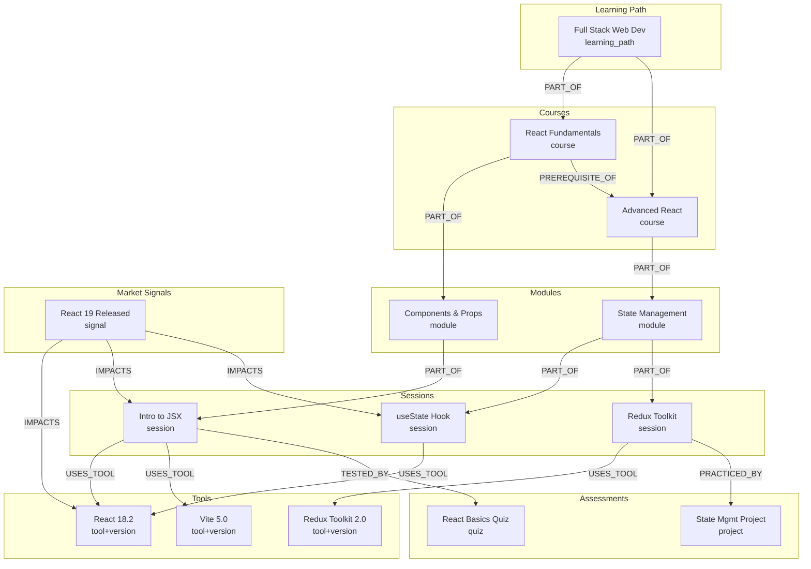

---

## 7. Retrieval Architecture

> **For beginners:** "Retrieval" means finding relevant curriculum content.
> We use three methods together for best results.

### Three-Layer Retrieval

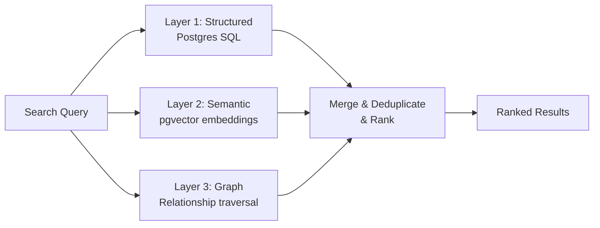

### Layer 1: Structured Retrieval (PostgreSQL)

```python
async def structured_retrieval(tools: list[str], topic: str) -> list[dict]:
    """Exact match retrieval from structured data."""

    # Find sessions that use specific tools
    tool_results = await supabase.table("curriculum_documents") \
        .select("*") \
        .or_(",".join([f"tools.cs.{{{t}}}" for t in tools])) \
        .execute()

    # Find sessions matching topic keywords
    topic_results = await supabase.table("curriculum_documents") \
        .select("*") \
        .textSearch("content", topic, type="websearch") \
        .execute()

    return merge_results(tool_results.data, topic_results.data)
```

### Layer 2: Semantic Retrieval (pgvector)

```sql
-- Postgres function for semantic search
CREATE OR REPLACE FUNCTION match_curriculum_documents(
    query_embedding vector(1536),
    match_threshold float DEFAULT 0.7,
    match_count int DEFAULT 20
)
RETURNS TABLE (
    id UUID,
    content TEXT,
    document_type VARCHAR,
    metadata JSONB,
    similarity float
)
LANGUAGE plpgsql
AS $$
BEGIN
    RETURN QUERY
    SELECT
        cd.id,
        cd.content,
        cd.document_type,
        cd.metadata,
        1 - (ce.embedding <=> query_embedding) AS similarity
    FROM curriculum_embeddings ce
    JOIN curriculum_documents cd ON cd.id = ce.document_id
    WHERE 1 - (ce.embedding <=> query_embedding) > match_threshold
    ORDER BY ce.embedding <=> query_embedding
    LIMIT match_count;
END;
$$;
```

```python
from openai import OpenAI

async def generate_embedding(text: str) -> list[float]:
    """Generate embedding using OpenAI (cheaper than Claude for embeddings)."""
    client = OpenAI()
    response = client.embeddings.create(
        model="text-embedding-3-small",
        input=text,
    )
    return response.data[0].embedding

async def semantic_retrieval(query: str, threshold: float = 0.7) -> list[dict]:
    """Find semantically similar curriculum content."""
    embedding = await generate_embedding(query)

    results = await supabase.rpc(
        "match_curriculum_documents",
        {
            "query_embedding": embedding,
            "match_threshold": threshold,
            "match_count": 20,
        }
    ).execute()

    return results.data
```

### Layer 3: Graph Retrieval

```python
async def graph_retrieval(tools: list[str], topic: str) -> list[dict]:
    """Find connected curriculum items via graph relationships."""

    # Find tool nodes
    tool_nodes = await supabase.table("curriculum_graph_nodes") \
        .select("node_id, name") \
        .eq("node_type", "tool") \
        .in_("name", tools) \
        .execute()

    if not tool_nodes.data:
        return []

    tool_ids = [n["node_id"] for n in tool_nodes.data]

    # Traverse graph: tool → sessions → modules → courses
    results = await supabase.rpc(
        "traverse_curriculum_graph",
        {"start_node_ids": tool_ids, "max_depth": 3}
    ).execute()

    return results.data
```

### Merge & Rank

```python
def merge_and_rank(
    structured: list[dict],
    semantic: list[dict],
    graph: list[dict],
) -> list[dict]:
    """Merge results from all three retrieval layers."""
    seen = set()
    merged = []

    for item in structured:
        key = item.get("id") or item.get("node_id")
        if key not in seen:
            seen.add(key)
            item["retrieval_source"] = "structured"
            item["rank_score"] = 1.0  # Exact matches score highest
            merged.append(item)

    for item in semantic:
        key = item.get("id")
        if key not in seen:
            seen.add(key)
            item["retrieval_source"] = "semantic"
            item["rank_score"] = item.get("similarity", 0.5)
            merged.append(item)
        else:
            # Boost items found by multiple methods
            for m in merged:
                if m.get("id") == key:
                    m["rank_score"] = min(m["rank_score"] + 0.2, 1.0)

    for item in graph:
        key = item.get("node_id")
        if key not in seen:
            seen.add(key)
            item["retrieval_source"] = "graph"
            item["rank_score"] = 0.7
            merged.append(item)

    return sorted(merged, key=lambda x: x["rank_score"], reverse=True)
```

---

## 8. Severity Engine

> **For beginners:** Severity = how urgent is this gap?
> Critical = fix immediately. Low = can wait.

### Scoring Framework

```python
from dataclasses import dataclass

@dataclass
class SeverityFactors:
    industry_adoption: float      # 0-1: how widely adopted is the change
    deprecation_risk: float       # 0-1: chance the old way stops working
    employability_impact: float   # 0-1: does this affect job readiness
    assessment_impact: float      # 0-1: are assessments now wrong
    project_impact: float         # 0-1: do projects break/become outdated
    coverage_impact: float        # 0-1: how much curriculum is affected
    affected_sessions_count: int  # raw count of affected sessions

SEVERITY_WEIGHTS = {
    "industry_adoption": 0.20,
    "deprecation_risk": 0.25,
    "employability_impact": 0.20,
    "assessment_impact": 0.10,
    "project_impact": 0.10,
    "coverage_impact": 0.10,
    "affected_sessions_ratio": 0.05,  # normalized: count / total_sessions
}

def calculate_severity(gap: dict, state: dict) -> dict:
    """Calculate gap severity using weighted scoring."""

    # Get factor scores (from LLM or rules)
    factors = score_severity_factors(gap, state)

    # Calculate weighted score
    total_sessions = len(state.get("relevant_sessions", [])) or 1
    session_ratio = min(factors.affected_sessions_count / total_sessions, 1.0)

    weighted_score = (
        factors.industry_adoption * SEVERITY_WEIGHTS["industry_adoption"]
        + factors.deprecation_risk * SEVERITY_WEIGHTS["deprecation_risk"]
        + factors.employability_impact * SEVERITY_WEIGHTS["employability_impact"]
        + factors.assessment_impact * SEVERITY_WEIGHTS["assessment_impact"]
        + factors.project_impact * SEVERITY_WEIGHTS["project_impact"]
        + factors.coverage_impact * SEVERITY_WEIGHTS["coverage_impact"]
        + session_ratio * SEVERITY_WEIGHTS["affected_sessions_ratio"]
    )

    # Map score to severity level
    if weighted_score >= 0.8:
        level = "critical"
    elif weighted_score >= 0.6:
        level = "high"
    elif weighted_score >= 0.35:
        level = "medium"
    else:
        level = "low"

    return {
        "level": level,
        "score": round(weighted_score, 3),
        "factors": {
            "industry_adoption": factors.industry_adoption,
            "deprecation_risk": factors.deprecation_risk,
            "employability_impact": factors.employability_impact,
            "assessment_impact": factors.assessment_impact,
            "project_impact": factors.project_impact,
            "coverage_impact": factors.coverage_impact,
            "affected_sessions_count": factors.affected_sessions_count,
        },
    }
```

### Severity Factor Scoring via LLM

```python
SEVERITY_SCORING_PROMPT = """Score these severity factors for the curriculum gap below.

Gap: {gap_statement}
Gap Type: {gap_type}
Market Signal: {signal}
Tools Affected: {tools}
Curriculum Sessions Affected: {session_count}

Score each factor from 0.0 (no impact) to 1.0 (maximum impact):

1. industry_adoption: How widely has the industry adopted this change?
   - 1.0 = universal adoption (everyone switched)
   - 0.5 = moderate adoption (growing trend)
   - 0.0 = experimental/niche

2. deprecation_risk: Will the current approach stop working?
   - 1.0 = deprecated, will break soon
   - 0.5 = deprecated but still works
   - 0.0 = no deprecation risk

3. employability_impact: Does this affect student job readiness?
   - 1.0 = companies require the new approach
   - 0.5 = helpful but not required
   - 0.0 = no impact on jobs

4. assessment_impact: Are current assessments now incorrect?
   - 1.0 = assessments test deprecated approaches
   - 0.5 = partially outdated
   - 0.0 = assessments still valid

5. project_impact: Do student projects break or become outdated?
   - 1.0 = projects won't work with new versions
   - 0.5 = projects work but use old patterns
   - 0.0 = projects unaffected

6. coverage_impact: How much curriculum is affected?
   - 1.0 = core curriculum (many sessions)
   - 0.5 = moderate coverage
   - 0.0 = minor/elective content

Return JSON:
{{"industry_adoption": 0.0, "deprecation_risk": 0.0, "employability_impact": 0.0, "assessment_impact": 0.0, "project_impact": 0.0, "coverage_impact": 0.0}}"""
```

### Severity Decision Matrix

| Score Range | Level | Meaning | Example |
|-------------|-------|---------|---------|
| 0.80 - 1.00 | **Critical** | Curriculum teaches deprecated/broken content | React class components as primary, React 19 out |
| 0.60 - 0.79 | **High** | Major gap, affects employability | No TypeScript coverage, industry standard |
| 0.35 - 0.59 | **Medium** | Notable gap, update recommended | Using Webpack when Vite is now standard |
| 0.00 - 0.34 | **Low** | Minor, can wait for scheduled review | Minor API syntax change |

---

## 9. When-To-Act Engine

> **For beginners:** This calculates WHEN you should fix a gap.
> Critical gaps = 7 days. Low gaps = next quarterly review.

### Calculation Logic

```python
from datetime import datetime, timedelta

URGENCY_RULES = {
    "critical": {
        "base_days": 7,
        "max_days": 14,
        "rationale": "Breaking change or deprecated content. Immediate action needed.",
    },
    "high": {
        "base_days": 30,
        "max_days": 45,
        "rationale": "Significant gap affecting student outcomes. Action within 1 month.",
    },
    "medium": {
        "base_days": 90,
        "max_days": 120,
        "rationale": "Notable gap. Schedule for next curriculum review cycle.",
    },
    "low": {
        "base_days": 180,
        "max_days": 365,
        "rationale": "Minor gap. Address in next quarterly review.",
    },
}

def calculate_when_to_act(gap: dict) -> dict:
    """Calculate action deadline based on severity and context."""
    severity = gap.get("severity", "medium")
    rules = URGENCY_RULES[severity]

    base_days = rules["base_days"]

    # Adjust based on adoption rate
    adoption = gap.get("severity_factors", {}).get("industry_adoption", 0.5)
    if adoption > 0.8:
        base_days = int(base_days * 0.7)  # Faster if widely adopted
    elif adoption < 0.3:
        base_days = int(base_days * 1.3)  # Slower if not widely adopted

    # Adjust based on deprecation risk
    deprecation = gap.get("severity_factors", {}).get("deprecation_risk", 0)
    if deprecation > 0.8:
        base_days = max(base_days - 7, 3)  # Very urgent if things will break

    # Cap at max
    base_days = min(base_days, rules["max_days"])

    action_date = datetime.now() + timedelta(days=base_days)

    return {
        "date": action_date.strftime("%Y-%m-%d"),
        "days_from_now": base_days,
        "rationale": rules["rationale"],
        "adjustments": f"Adoption rate: {adoption:.1f}, Deprecation risk: {deprecation:.1f}",
    }
```

### When-To-Act Output Examples

| Gap | Severity | Adoption | Deprecation | When To Act | Rationale |
|-----|----------|----------|-------------|-------------|-----------|
| React 19 migration | Critical | 0.9 | 0.7 | 5 days | Breaking changes, high adoption |
| Add Bun.js coverage | Medium | 0.4 | 0.0 | 117 days | Growing but not urgent |
| Update Redux examples | High | 0.8 | 0.3 | 21 days | Outdated patterns, widely adopted |
| Add Deno 2 elective | Low | 0.2 | 0.0 | 234 days | Niche, future review |

---

## 10. Feedback Learning System

> **For beginners:** When a human reviewer rejects a gap or edits a digest,
> we learn from that to make better suggestions next time.

### Feedback Capture Schema

```python
class ReviewFeedback(TypedDict):
    feedback_id: str
    entity_type: str      # "digest" or "gap"
    entity_id: str        # digest_id or gap_id
    reviewer: str         # reviewer email/name
    decision: str         # approved | rejected | needs_review | edited
    comments: str         # free text feedback
    edited_content: dict  # if reviewer edited, the changes
    original_content: dict  # what the system produced
    timestamp: str
    prompt_version: str   # which prompt version produced this
```

### Feedback Analysis Workflow

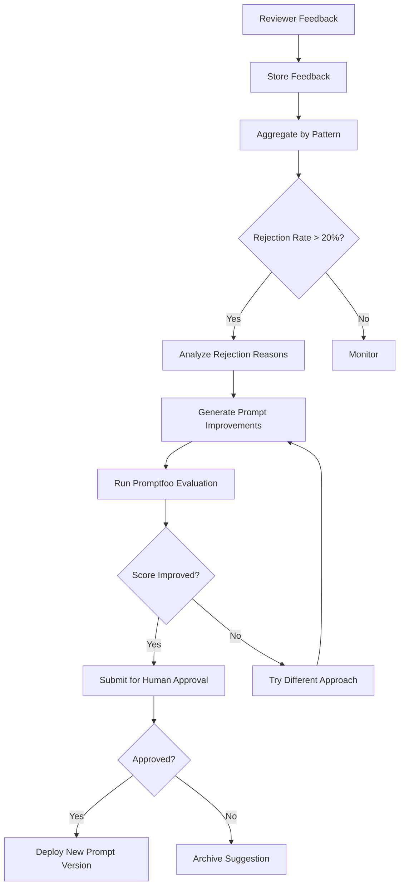

### Feedback Analysis Logic

```python
async def analyze_feedback_patterns(entity_type: str, window_days: int = 30):
    """Analyze recent feedback to identify improvement areas."""

    # Get recent feedback
    feedback = await supabase.table("review_feedback") \
        .select("*") \
        .eq("entity_type", entity_type) \
        .gte("timestamp", (datetime.now() - timedelta(days=window_days)).isoformat()) \
        .execute()

    total = len(feedback.data)
    if total < 10:
        return None  # Not enough data

    rejections = [f for f in feedback.data if f["decision"] == "rejected"]
    edits = [f for f in feedback.data if f["decision"] == "edited"]

    rejection_rate = len(rejections) / total
    edit_rate = len(edits) / total

    # Cluster rejection reasons
    if rejections:
        reasons = await cluster_rejection_reasons(rejections)

    return {
        "total_reviews": total,
        "rejection_rate": rejection_rate,
        "edit_rate": edit_rate,
        "top_rejection_reasons": reasons if rejections else [],
        "needs_improvement": rejection_rate > 0.2 or edit_rate > 0.3,
    }

async def cluster_rejection_reasons(rejections: list[dict]) -> list[dict]:
    """Use LLM to cluster rejection comments into themes."""
    llm = ChatAnthropic(model="claude-sonnet-4-20250514", temperature=0)

    comments = "\n".join([
        f"- {r['comments']}" for r in rejections if r.get("comments")
    ])

    response = await llm.ainvoke(
        f"""Analyze these rejection comments and identify the top 3-5 themes.

Comments:
{comments}

Return JSON:
{{"themes": [{{"theme": "...", "count": N, "example": "...", "suggested_fix": "..."}}]}}"""
    )

    return json.loads(response.content)["themes"]
```

### Prompt Improvement Pipeline

```python
async def generate_prompt_improvement(
    current_prompt: str,
    feedback_analysis: dict,
    prompt_name: str,
) -> dict:
    """Generate improved prompt based on feedback."""
    llm = ChatAnthropic(model="claude-sonnet-4-20250514", temperature=0.3)

    response = await llm.ainvoke(
        f"""You are improving an LLM prompt based on reviewer feedback.

CURRENT PROMPT:
{current_prompt}

FEEDBACK ANALYSIS:
Rejection rate: {feedback_analysis['rejection_rate']:.1%}
Top rejection themes:
{json.dumps(feedback_analysis['top_rejection_reasons'], indent=2)}

TASK:
1. Identify what in the current prompt leads to these rejections
2. Propose a revised prompt that addresses the issues
3. Explain your changes

Return JSON:
{{
    "revised_prompt": "...",
    "changes_made": ["list of changes"],
    "expected_improvement": "what should improve",
    "risk_assessment": "what might break"
}}"""
    )

    improvement = json.loads(response.content)

    # Save as candidate version
    new_version = await supabase.table("prompt_versions").insert({
        "prompt_name": prompt_name,
        "version": await get_next_version(prompt_name),
        "prompt_text": improvement["revised_prompt"],
        "changes": improvement["changes_made"],
        "status": "candidate",
        "created_from_feedback": True,
        "feedback_analysis_id": feedback_analysis.get("id"),
    }).execute()

    return {
        "version_id": new_version.data[0]["id"],
        "improvement": improvement,
    }
```

---

## 11. Skill Evolution System

> **For beginners:** "Skills" are reusable capabilities.
> "Web Extraction" is a skill. "Severity Assessment" is a skill.
> We track how well each skill performs and improve them over time.

### Skill Registry

```python
DIGEST_AGENT_SKILLS = [
    {
        "skill_id": "web_extraction",
        "skill_name": "Web Extraction",
        "description": "Extract clean content from URLs via Firecrawl/Playwright",
        "prompt_version": "v1.0",
        "metrics": ["extraction_success_rate", "content_quality_score"],
    },
    {
        "skill_id": "source_credibility",
        "skill_name": "Source Credibility Assessment",
        "description": "Score source trustworthiness",
        "prompt_version": "v1.0",
        "metrics": ["accuracy_vs_human"],
    },
    {
        "skill_id": "tool_detection",
        "skill_name": "Tool Detection",
        "description": "Detect tools and versions in content",
        "prompt_version": "v1.0",
        "metrics": ["precision", "recall"],
    },
    {
        "skill_id": "version_detection",
        "skill_name": "Version Detection",
        "description": "Extract version numbers accurately",
        "prompt_version": "v1.0",
        "metrics": ["accuracy"],
    },
    {
        "skill_id": "evidence_extraction",
        "skill_name": "Evidence Extraction",
        "description": "Extract supporting evidence quotes",
        "prompt_version": "v1.0",
        "metrics": ["faithfulness", "relevance"],
    },
    {
        "skill_id": "relevance_classification",
        "skill_name": "Relevance Classification",
        "description": "Classify curriculum relevance of signals",
        "prompt_version": "v1.0",
        "metrics": ["accuracy_vs_human", "false_positive_rate"],
    },
]

GAP_ANALYZER_SKILLS = [
    {
        "skill_id": "curriculum_retrieval",
        "skill_name": "Curriculum Retrieval",
        "description": "Hybrid retrieval of relevant curriculum content",
        "prompt_version": "v1.0",
        "metrics": ["recall", "precision"],
    },
    {
        "skill_id": "coverage_analysis",
        "skill_name": "Coverage Analysis",
        "description": "Analyze topic coverage in curriculum",
        "prompt_version": "v1.0",
        "metrics": ["completeness", "accuracy"],
    },
    {
        "skill_id": "gap_detection",
        "skill_name": "Gap Detection",
        "description": "Identify curriculum gaps from market signals",
        "prompt_version": "v1.0",
        "metrics": ["precision", "recall", "false_positive_rate"],
    },
    {
        "skill_id": "severity_assessment",
        "skill_name": "Severity Assessment",
        "description": "Score gap severity accurately",
        "prompt_version": "v1.0",
        "metrics": ["correlation_with_human"],
    },
    {
        "skill_id": "impact_analysis",
        "skill_name": "Impact Analysis",
        "description": "Identify all impacted curriculum items",
        "prompt_version": "v1.0",
        "metrics": ["completeness", "false_positive_rate"],
    },
    {
        "skill_id": "action_recommendation",
        "skill_name": "Action Recommendation",
        "description": "Generate actionable improvement items",
        "prompt_version": "v1.0",
        "metrics": ["actionability_score", "acceptance_rate"],
    },
    {
        "skill_id": "critic_validation",
        "skill_name": "Validation",
        "description": "Validate gap findings for accuracy",
        "prompt_version": "v1.0",
        "metrics": ["false_negative_rate", "false_positive_catch_rate"],
    },
]
```

### Skill Evolution Process

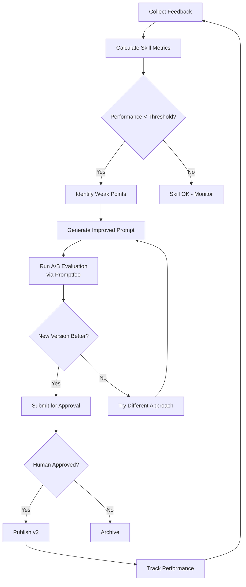

### Skill Performance Tracking

```python
async def evaluate_skill_performance(skill_id: str, window_days: int = 30) -> dict:
    """Calculate skill performance from recent usage."""

    # Get recent feedback for this skill's outputs
    usage = await supabase.table("agent_skills") \
        .select("*") \
        .eq("skill_id", skill_id) \
        .single() \
        .execute()

    # Get rejection rates for outputs produced by this skill
    feedback = await supabase.table("review_feedback") \
        .select("decision, comments") \
        .gte("timestamp", (datetime.now() - timedelta(days=window_days)).isoformat()) \
        .execute()

    total = len(feedback.data)
    if total == 0:
        return {"status": "insufficient_data"}

    accepted = len([f for f in feedback.data if f["decision"] == "approved"])
    rejection_rate = 1 - (accepted / total)

    return {
        "skill_id": skill_id,
        "usage_count": total,
        "acceptance_rate": accepted / total,
        "rejection_rate": rejection_rate,
        "needs_improvement": rejection_rate > 0.2,
        "current_version": usage.data["prompt_version"],
    }
```

---

## 12. LangGraph Architecture

> **For beginners:** This section shows how the two agents are built
> using LangGraph's state machine pattern.

### State Definitions

Already covered in Sections 4 and 5. Key concepts:

- **State**: A TypedDict that holds all data flowing through the graph
- **Nodes**: Functions that read state, do work, and return updated state
- **Edges**: Connections between nodes (what runs after what)
- **Conditional Edges**: if/else routing based on state
- **Checkpointer**: Saves state so we can resume after human review

### State Transitions — Digest Agent

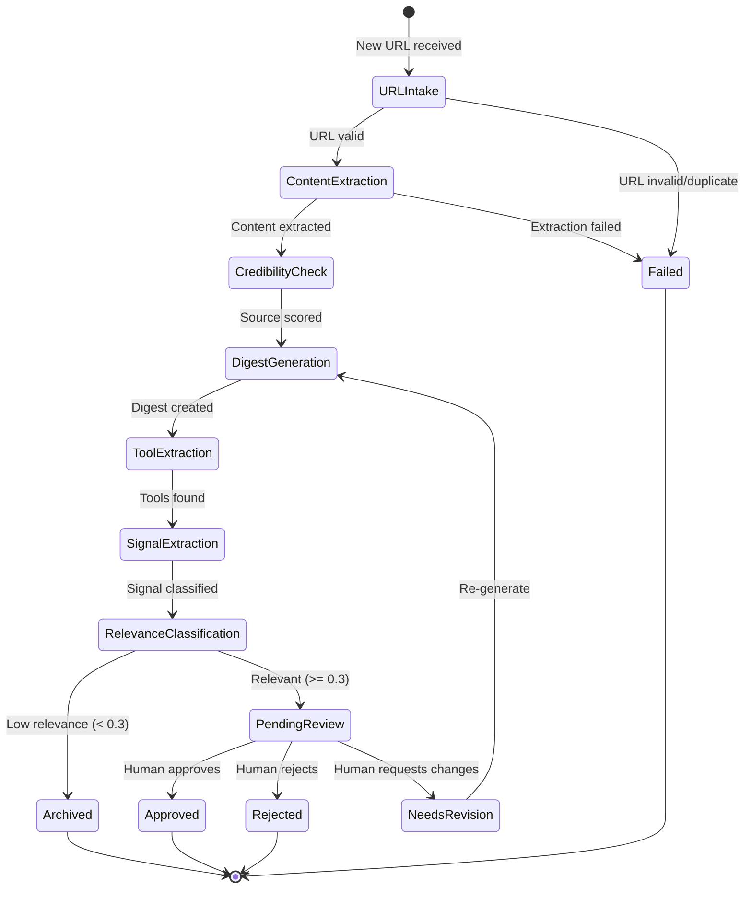

### State Transitions — Gap Analyzer

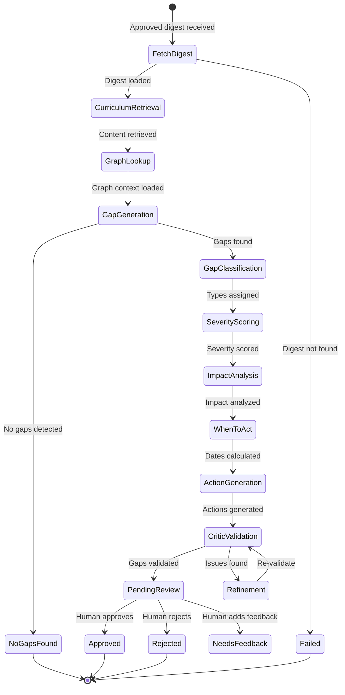

### Retry Strategy

```python
from langgraph.pregel import RetryPolicy

# Retry LLM calls on transient errors
retry_policy = RetryPolicy(
    max_attempts=3,
    initial_interval=1.0,
    backoff_factor=2.0,
    retry_on=(
        anthropic.APITimeoutError,
        anthropic.APIConnectionError,
        anthropic.RateLimitError,
    ),
)

# Apply to specific nodes
graph.add_node("generate_digest", digest_generator_node, retry=retry_policy)
graph.add_node("extract_tools", tool_version_extractor_node, retry=retry_policy)
```

### Error Handling

```python
async def error_handler_node(state: DigestState) -> DigestState:
    """Handle errors gracefully."""
    errors = state.get("errors", [])

    # Log to database
    await supabase.table("audit_logs").insert({
        "event_type": "workflow_error",
        "entity_type": "digest",
        "entity_id": state.get("digest_id") or state.get("url_id"),
        "details": {"errors": errors, "url": state["url"]},
    }).execute()

    return {**state, "status": "failed"}
```

---

## 13. Database Schema

> **For beginners:** This is the complete database design.
> Each table stores a specific type of data.

### Complete Schema

```sql
-- ============================================
-- URL REGISTRY
-- Stores all URLs to be processed
-- ============================================
CREATE TABLE url_registry (
    id UUID PRIMARY KEY DEFAULT gen_random_uuid(),
    url TEXT NOT NULL UNIQUE,
    domain VARCHAR(500),
    source_name VARCHAR(500),
    credibility_tier VARCHAR(50) DEFAULT 'unknown',
    -- Tiers: official_docs, major_blog, tech_publication, personal_blog, social_media, unknown
    category VARCHAR(100),
    -- Categories: frontend, backend, devops, testing, css, etc.
    tags TEXT[] DEFAULT '{}',
    is_active BOOLEAN DEFAULT true,
    last_crawled_at TIMESTAMPTZ,
    crawl_frequency VARCHAR(50) DEFAULT 'weekly',
    -- weekly, daily, monthly
    added_by VARCHAR(255),
    created_at TIMESTAMPTZ DEFAULT NOW(),
    updated_at TIMESTAMPTZ DEFAULT NOW()
);

CREATE INDEX idx_url_registry_domain ON url_registry(domain);
CREATE INDEX idx_url_registry_active ON url_registry(is_active);
CREATE INDEX idx_url_registry_category ON url_registry(category);

-- ============================================
-- EXTRACTED CONTENT
-- Raw content from web scraping
-- ============================================
CREATE TABLE extracted_content (
    id UUID PRIMARY KEY DEFAULT gen_random_uuid(),
    url_id UUID REFERENCES url_registry(id) ON DELETE CASCADE,
    url TEXT NOT NULL,
    raw_content TEXT,
    content_length INT,
    extraction_method VARCHAR(50),
    -- firecrawl, playwright
    extraction_status VARCHAR(50) NOT NULL,
    -- success, failed, partial
    error_message TEXT,
    metadata JSONB DEFAULT '{}',
    -- {title, description, author, published_date, etc.}
    created_at TIMESTAMPTZ DEFAULT NOW()
);

CREATE INDEX idx_extracted_content_url ON extracted_content(url_id);
CREATE INDEX idx_extracted_content_status ON extracted_content(extraction_status);

-- ============================================
-- MARKET DIGESTS
-- Structured intelligence from content
-- ============================================
CREATE TABLE market_digests (
    digest_id UUID PRIMARY KEY DEFAULT gen_random_uuid(),
    url_id UUID REFERENCES url_registry(id),
    url TEXT NOT NULL,
    source_title VARCHAR(1000),
    source_type VARCHAR(100),
    topic VARCHAR(500),
    summary TEXT,
    market_signal VARCHAR(100),
    -- new_release, deprecation, breaking_change, best_practice_change,
    -- security_update, new_tool, trend_shift, performance_improvement
    evidence_snippet TEXT,
    tools_versions JSONB DEFAULT '[]',
    -- [{tool, version, change_type}]
    relevance_score FLOAT,
    relevance_reason TEXT,
    confidence FLOAT,
    credibility_score FLOAT,
    status VARCHAR(50) DEFAULT 'pending',
    -- pending, extracted, generated, pending_review, approved, rejected
    workflow_run_id UUID,
    total_tokens INT DEFAULT 0,
    total_cost FLOAT DEFAULT 0,
    created_at TIMESTAMPTZ DEFAULT NOW(),
    updated_at TIMESTAMPTZ DEFAULT NOW()
);

CREATE INDEX idx_digests_status ON market_digests(status);
CREATE INDEX idx_digests_signal ON market_digests(market_signal);
CREATE INDEX idx_digests_created ON market_digests(created_at DESC);
CREATE INDEX idx_digests_tools ON market_digests USING gin(tools_versions);

-- ============================================
-- CURRICULUM DOCUMENTS
-- Your curriculum content for retrieval
-- ============================================
CREATE TABLE curriculum_documents (
    id UUID PRIMARY KEY DEFAULT gen_random_uuid(),
    document_type VARCHAR(100) NOT NULL,
    -- session, project, coding_challenge, assessment, quiz, module, course
    title VARCHAR(1000) NOT NULL,
    content TEXT NOT NULL,
    course_name VARCHAR(500),
    module_name VARCHAR(500),
    session_name VARCHAR(500),
    tools TEXT[] DEFAULT '{}',
    -- ["React", "Node.js", "Jest"]
    versions JSONB DEFAULT '{}',
    -- {"React": "18.2", "Node.js": "18"}
    difficulty VARCHAR(50),
    -- beginner, intermediate, advanced
    metadata JSONB DEFAULT '{}',
    is_active BOOLEAN DEFAULT true,
    created_at TIMESTAMPTZ DEFAULT NOW(),
    updated_at TIMESTAMPTZ DEFAULT NOW()
);

CREATE INDEX idx_curriculum_type ON curriculum_documents(document_type);
CREATE INDEX idx_curriculum_course ON curriculum_documents(course_name);
CREATE INDEX idx_curriculum_tools ON curriculum_documents USING gin(tools);
CREATE INDEX idx_curriculum_fulltext ON curriculum_documents
    USING gin(to_tsvector('english', content));

-- ============================================
-- CURRICULUM EMBEDDINGS
-- Vector embeddings for semantic search
-- ============================================
CREATE EXTENSION IF NOT EXISTS vector;

CREATE TABLE curriculum_embeddings (
    id UUID PRIMARY KEY DEFAULT gen_random_uuid(),
    document_id UUID REFERENCES curriculum_documents(id) ON DELETE CASCADE,
    embedding vector(1536),  -- OpenAI text-embedding-3-small dimension
    chunk_index INT DEFAULT 0,
    chunk_text TEXT,
    created_at TIMESTAMPTZ DEFAULT NOW()
);

CREATE INDEX idx_embeddings_document ON curriculum_embeddings(document_id);
CREATE INDEX idx_embeddings_vector ON curriculum_embeddings
    USING ivfflat (embedding vector_cosine_ops) WITH (lists = 100);

-- ============================================
-- CURRICULUM GRAPH (see Section 6)
-- ============================================
-- curriculum_graph_nodes (defined in Section 6)
-- curriculum_graph_edges (defined in Section 6)

-- ============================================
-- CURRICULUM GAPS
-- Detected gaps from analysis
-- ============================================
CREATE TABLE curriculum_gaps (
    gap_id UUID PRIMARY KEY DEFAULT gen_random_uuid(),
    digest_id UUID REFERENCES market_digests(digest_id),
    gap_type VARCHAR(100) NOT NULL,
    -- design_gap, tool_gap, version_gap, practice_gap,
    -- project_gap, assessment_gap, quiz_gap, documentation_gap
    market_signal VARCHAR(500),
    curriculum_evidence TEXT,
    gap_statement TEXT NOT NULL,
    what_to_act TEXT,
    why_to_act TEXT,
    when_to_act DATE,
    when_to_act_rationale TEXT,
    severity VARCHAR(50),
    -- critical, high, medium, low
    severity_score FLOAT,
    severity_factors JSONB DEFAULT '{}',
    impacted_content_area TEXT,
    impacted_courses TEXT[] DEFAULT '{}',
    impacted_sessions TEXT[] DEFAULT '{}',
    impacted_projects TEXT[] DEFAULT '{}',
    impacted_assessments TEXT[] DEFAULT '{}',
    impacted_quizzes TEXT[] DEFAULT '{}',
    impacted_tools TEXT[] DEFAULT '{}',
    action_items JSONB DEFAULT '[]',
    recommended_owner VARCHAR(255),
    evidence_source TEXT,
    confidence FLOAT,
    critic_feedback JSONB DEFAULT '[]',
    decision_status VARCHAR(50) DEFAULT 'pending_review',
    -- pending_review, approved, rejected, needs_review
    workflow_run_id UUID,
    total_tokens INT DEFAULT 0,
    total_cost FLOAT DEFAULT 0,
    created_at TIMESTAMPTZ DEFAULT NOW(),
    updated_at TIMESTAMPTZ DEFAULT NOW()
);

CREATE INDEX idx_gaps_status ON curriculum_gaps(decision_status);
CREATE INDEX idx_gaps_severity ON curriculum_gaps(severity);
CREATE INDEX idx_gaps_type ON curriculum_gaps(gap_type);
CREATE INDEX idx_gaps_when ON curriculum_gaps(when_to_act);
CREATE INDEX idx_gaps_digest ON curriculum_gaps(digest_id);
CREATE INDEX idx_gaps_created ON curriculum_gaps(created_at DESC);

-- ============================================
-- REVIEW FEEDBACK
-- Human review decisions and comments
-- ============================================
CREATE TABLE review_feedback (
    feedback_id UUID PRIMARY KEY DEFAULT gen_random_uuid(),
    entity_type VARCHAR(50) NOT NULL,
    -- digest, gap
    entity_id UUID NOT NULL,
    reviewer VARCHAR(255) NOT NULL,
    decision VARCHAR(50) NOT NULL,
    -- approved, rejected, needs_review, edited
    comments TEXT,
    edited_content JSONB,
    original_content JSONB,
    prompt_version VARCHAR(50),
    created_at TIMESTAMPTZ DEFAULT NOW()
);

CREATE INDEX idx_feedback_entity ON review_feedback(entity_type, entity_id);
CREATE INDEX idx_feedback_reviewer ON review_feedback(reviewer);
CREATE INDEX idx_feedback_decision ON review_feedback(decision);
CREATE INDEX idx_feedback_created ON review_feedback(created_at DESC);

-- ============================================
-- REVIEW DECISIONS
-- Aggregate review state
-- ============================================
CREATE TABLE review_decisions (
    id UUID PRIMARY KEY DEFAULT gen_random_uuid(),
    entity_type VARCHAR(50) NOT NULL,
    entity_id UUID NOT NULL,
    current_status VARCHAR(50) NOT NULL,
    review_count INT DEFAULT 0,
    last_reviewer VARCHAR(255),
    last_reviewed_at TIMESTAMPTZ,
    created_at TIMESTAMPTZ DEFAULT NOW(),
    updated_at TIMESTAMPTZ DEFAULT NOW(),
    UNIQUE(entity_type, entity_id)
);

-- ============================================
-- WORKFLOW COSTS
-- Token and cost tracking per node
-- ============================================
CREATE TABLE workflow_costs (
    id UUID PRIMARY KEY DEFAULT gen_random_uuid(),
    workflow_run_id UUID NOT NULL,
    workflow_type VARCHAR(100) NOT NULL,
    -- digest_agent, gap_analyzer
    node_name VARCHAR(200) NOT NULL,
    model VARCHAR(100),
    input_tokens INT DEFAULT 0,
    output_tokens INT DEFAULT 0,
    total_tokens INT DEFAULT 0,
    latency_ms INT DEFAULT 0,
    estimated_cost FLOAT DEFAULT 0,
    created_at TIMESTAMPTZ DEFAULT NOW()
);

CREATE INDEX idx_costs_workflow ON workflow_costs(workflow_run_id);
CREATE INDEX idx_costs_node ON workflow_costs(node_name);
CREATE INDEX idx_costs_created ON workflow_costs(created_at DESC);

-- ============================================
-- AGENT SKILLS
-- Skill registry and current state
-- ============================================
CREATE TABLE agent_skills (
    skill_id VARCHAR(100) PRIMARY KEY,
    skill_name VARCHAR(255) NOT NULL,
    agent_type VARCHAR(100) NOT NULL,
    -- digest_agent, gap_analyzer
    description TEXT,
    current_prompt_version VARCHAR(50),
    evaluation_score FLOAT,
    usage_count INT DEFAULT 0,
    acceptance_rate FLOAT,
    last_evaluated_at TIMESTAMPTZ,
    created_at TIMESTAMPTZ DEFAULT NOW(),
    updated_at TIMESTAMPTZ DEFAULT NOW()
);

-- ============================================
-- SKILL VERSIONS
-- Version history for skills
-- ============================================
CREATE TABLE skill_versions (
    id UUID PRIMARY KEY DEFAULT gen_random_uuid(),
    skill_id VARCHAR(100) REFERENCES agent_skills(skill_id),
    version VARCHAR(50) NOT NULL,
    prompt_text TEXT NOT NULL,
    changes TEXT[],
    evaluation_score FLOAT,
    status VARCHAR(50) DEFAULT 'candidate',
    -- candidate, active, deprecated
    created_from_feedback BOOLEAN DEFAULT false,
    approved_by VARCHAR(255),
    approved_at TIMESTAMPTZ,
    created_at TIMESTAMPTZ DEFAULT NOW(),
    UNIQUE(skill_id, version)
);

-- ============================================
-- PROMPT VERSIONS
-- Track all prompt versions
-- ============================================
CREATE TABLE prompt_versions (
    id UUID PRIMARY KEY DEFAULT gen_random_uuid(),
    prompt_name VARCHAR(255) NOT NULL,
    version VARCHAR(50) NOT NULL,
    prompt_text TEXT NOT NULL,
    changes TEXT[],
    evaluation_score FLOAT,
    status VARCHAR(50) DEFAULT 'candidate',
    -- candidate, active, deprecated
    created_from_feedback BOOLEAN DEFAULT false,
    feedback_analysis_id UUID,
    approved_by VARCHAR(255),
    created_at TIMESTAMPTZ DEFAULT NOW(),
    UNIQUE(prompt_name, version)
);

CREATE INDEX idx_prompts_name ON prompt_versions(prompt_name);
CREATE INDEX idx_prompts_status ON prompt_versions(status);

-- ============================================
-- EVALUATION RUNS
-- Promptfoo evaluation results
-- ============================================
CREATE TABLE evaluation_runs (
    id UUID PRIMARY KEY DEFAULT gen_random_uuid(),
    suite_name VARCHAR(255) NOT NULL,
    -- digest_agent, gap_analyzer
    prompt_version VARCHAR(50),
    total_tests INT,
    passed INT,
    failed INT,
    score FLOAT,
    results JSONB,
    config JSONB,
    run_by VARCHAR(255),
    created_at TIMESTAMPTZ DEFAULT NOW()
);

CREATE INDEX idx_eval_suite ON evaluation_runs(suite_name);
CREATE INDEX idx_eval_created ON evaluation_runs(created_at DESC);

-- ============================================
-- AUDIT LOGS
-- Everything that happens
-- ============================================
CREATE TABLE audit_logs (
    id UUID PRIMARY KEY DEFAULT gen_random_uuid(),
    event_type VARCHAR(100) NOT NULL,
    -- url_added, digest_created, digest_reviewed, gap_created,
    -- gap_reviewed, prompt_updated, skill_updated, error
    entity_type VARCHAR(100),
    entity_id UUID,
    actor VARCHAR(255),
    -- user email or "system"
    details JSONB DEFAULT '{}',
    created_at TIMESTAMPTZ DEFAULT NOW()
);

CREATE INDEX idx_audit_type ON audit_logs(event_type);
CREATE INDEX idx_audit_entity ON audit_logs(entity_type, entity_id);
CREATE INDEX idx_audit_created ON audit_logs(created_at DESC);

-- ============================================
-- ROW LEVEL SECURITY (RLS)
-- ============================================
ALTER TABLE url_registry ENABLE ROW LEVEL SECURITY;
ALTER TABLE market_digests ENABLE ROW LEVEL SECURITY;
ALTER TABLE curriculum_gaps ENABLE ROW LEVEL SECURITY;
ALTER TABLE review_feedback ENABLE ROW LEVEL SECURITY;
ALTER TABLE audit_logs ENABLE ROW LEVEL SECURITY;

-- Allow authenticated users to read all
CREATE POLICY "Authenticated read" ON url_registry
    FOR SELECT USING (auth.role() = 'authenticated');

CREATE POLICY "Authenticated read" ON market_digests
    FOR SELECT USING (auth.role() = 'authenticated');

CREATE POLICY "Authenticated read" ON curriculum_gaps
    FOR SELECT USING (auth.role() = 'authenticated');
```

### Entity Relationship Diagram

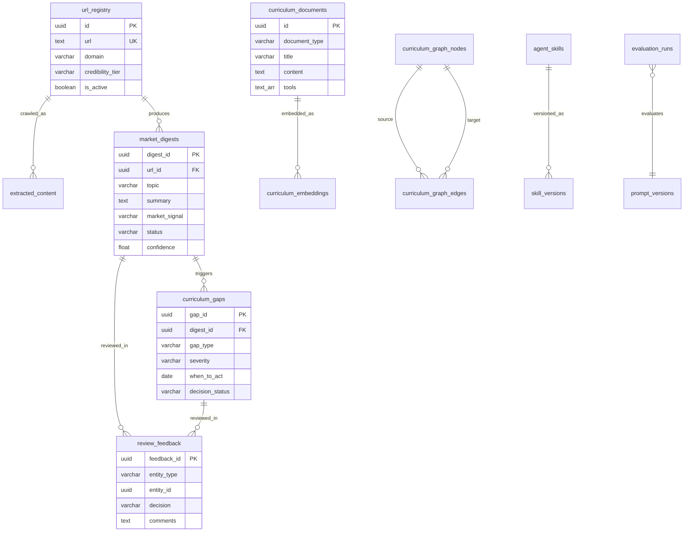

---

## 14. Cost Tracking Architecture

> **For beginners:** Every LLM call costs money. We track every token
> so you know exactly what the system costs.

### Cost Tracking Implementation

```python
import time
from contextlib import asynccontextmanager

# Cost per 1M tokens (as of 2025)
MODEL_COSTS = {
    "claude-sonnet-4-20250514": {"input": 3.00, "output": 15.00},
    "claude-opus-4-20250514": {"input": 15.00, "output": 75.00},
    "claude-haiku-3-5-20241022": {"input": 0.80, "output": 4.00},
    "gpt-4o": {"input": 2.50, "output": 10.00},
    "text-embedding-3-small": {"input": 0.02, "output": 0.00},
}

@asynccontextmanager
async def track_cost(workflow_run_id: str, node_name: str, model: str):
    """Context manager to track LLM costs per node."""
    start_time = time.time()
    tracker = {"input_tokens": 0, "output_tokens": 0}

    yield tracker

    elapsed_ms = int((time.time() - start_time) * 1000)
    total_tokens = tracker["input_tokens"] + tracker["output_tokens"]

    costs = MODEL_COSTS.get(model, {"input": 5.0, "output": 15.0})
    estimated_cost = (
        (tracker["input_tokens"] / 1_000_000) * costs["input"]
        + (tracker["output_tokens"] / 1_000_000) * costs["output"]
    )

    await supabase.table("workflow_costs").insert({
        "workflow_run_id": workflow_run_id,
        "workflow_type": "digest_agent",  # or gap_analyzer
        "node_name": node_name,
        "model": model,
        "input_tokens": tracker["input_tokens"],
        "output_tokens": tracker["output_tokens"],
        "total_tokens": total_tokens,
        "latency_ms": elapsed_ms,
        "estimated_cost": estimated_cost,
    }).execute()

# Usage in a node:
async def digest_generator_node(state: DigestState) -> DigestState:
    async with track_cost(state["workflow_run_id"], "digest_generator", "claude-sonnet-4-20250514") as tracker:
        response = await llm.ainvoke(prompt)
        tracker["input_tokens"] = response.usage_metadata["input_tokens"]
        tracker["output_tokens"] = response.usage_metadata["output_tokens"]
    # ... rest of node
```

### Cost Dashboard Queries

```sql
-- Cost per URL
SELECT
    d.url,
    SUM(wc.estimated_cost) as total_cost,
    SUM(wc.total_tokens) as total_tokens
FROM workflow_costs wc
JOIN market_digests d ON d.workflow_run_id = wc.workflow_run_id
GROUP BY d.url
ORDER BY total_cost DESC;

-- Cost per node (find expensive nodes)
SELECT
    node_name,
    COUNT(*) as invocations,
    AVG(estimated_cost) as avg_cost,
    SUM(estimated_cost) as total_cost,
    AVG(latency_ms) as avg_latency_ms
FROM workflow_costs
GROUP BY node_name
ORDER BY total_cost DESC;

-- Daily cost
SELECT
    DATE(created_at) as day,
    SUM(estimated_cost) as daily_cost,
    SUM(total_tokens) as daily_tokens,
    COUNT(DISTINCT workflow_run_id) as workflow_runs
FROM workflow_costs
GROUP BY DATE(created_at)
ORDER BY day DESC;

-- Cost per approved gap (efficiency metric)
SELECT
    AVG(total_cost) as avg_cost_per_approved_gap
FROM (
    SELECT
        g.gap_id,
        SUM(wc.estimated_cost) as total_cost
    FROM curriculum_gaps g
    JOIN workflow_costs wc ON g.workflow_run_id = wc.workflow_run_id
    WHERE g.decision_status = 'approved'
    GROUP BY g.gap_id
) sub;
```

### Cost Dashboard Design

```
┌─────────────────────────────────────────────────────┐
│  COST ANALYTICS                                     │
├─────────────────────────────────────────────────────┤
│                                                     │
│  Today: $4.23    This Week: $18.92    Month: $67.41 │
│                                                     │
│  ┌──────────────────────────────────────────┐       │
│  │  Daily Cost Trend (Bar Chart)            │       │
│  │  ████ $5.20                              │       │
│  │  ██   $2.10                              │       │
│  │  ███  $4.23                              │       │
│  └──────────────────────────────────────────┘       │
│                                                     │
│  Cost by Node:                                      │
│  ┌───────────────────────────────┐                  │
│  │ gap_candidate_generator  $12.40 (34%)    │       │
│  │ digest_generator         $8.20  (22%)    │       │
│  │ impact_analyzer          $6.10  (17%)    │       │
│  │ critic_validator         $4.80  (13%)    │       │
│  │ other nodes              $5.32  (14%)    │       │
│  └───────────────────────────────┘                  │
│                                                     │
│  Efficiency:                                        │
│  Avg cost per URL:           $0.42                  │
│  Avg cost per approved gap:  $1.87                  │
│  Avg latency per workflow:   12.3s                  │
│                                                     │
└─────────────────────────────────────────────────────┘
```

---

## 15. Langfuse Architecture

> **For beginners:** Langfuse is like a "debugger" for AI systems.
> It records every LLM call, so you can see what the AI did and why.

### Trace Hierarchy

```
Trace (one workflow run)
├── Span: url_intake
├── Span: content_extraction
│   └── Event: firecrawl_api_call
├── Span: credibility_check
├── Span: digest_generation
│   └── Generation: claude_llm_call (with prompt, output, tokens, cost)
├── Span: tool_extraction
│   └── Generation: claude_llm_call
├── Span: signal_extraction
│   └── Generation: claude_llm_call
├── Span: relevance_classification
│   └── Generation: claude_llm_call
└── Span: review_gate
    └── Event: human_decision (approved/rejected)
```

### Integration Implementation

```python
from langfuse.callback import CallbackHandler as LangfuseCallbackHandler
from langfuse import Langfuse

langfuse = Langfuse(
    public_key=settings.LANGFUSE_PUBLIC_KEY,
    secret_key=settings.LANGFUSE_SECRET_KEY,
    host=settings.LANGFUSE_HOST,
)

def create_langfuse_handler(
    trace_name: str,
    session_id: str,
    user_id: str = None,
    metadata: dict = None,
) -> LangfuseCallbackHandler:
    """Create Langfuse callback handler for LangChain."""
    return LangfuseCallbackHandler(
        trace_name=trace_name,
        session_id=session_id,
        user_id=user_id,
        metadata=metadata or {},
    )

# Usage in workflow
async def run_digest_workflow(url: str, url_id: str):
    """Run digest agent with full Langfuse tracing."""
    session_id = f"digest_{url_id}"

    # Create trace
    trace = langfuse.trace(
        name="digest_workflow",
        session_id=session_id,
        metadata={"url": url},
    )

    # Each node creates a span
    with trace.span(name="content_extraction") as span:
        content = await extract_content(url)
        span.update(
            input={"url": url},
            output={"content_length": len(content)},
        )

    with trace.span(name="digest_generation") as span:
        generation = span.generation(
            name="claude_digest",
            model="claude-sonnet-4-20250514",
            input=digest_prompt,
        )
        response = await llm.ainvoke(digest_prompt)
        generation.end(
            output=response.content,
            usage={
                "input": response.usage_metadata["input_tokens"],
                "output": response.usage_metadata["output_tokens"],
            },
        )

    # Link human review to trace
    trace.event(
        name="human_review",
        metadata={"status": "pending_review"},
    )

    langfuse.flush()
```

### Langfuse Dashboard Views

```
1. Trace Explorer
   - See all workflow runs
   - Filter by status, cost, latency
   - Click into individual traces

2. Generation Analytics
   - Token usage over time
   - Cost per model
   - Latency percentiles

3. Prompt Management
   - Version prompts in Langfuse
   - Compare versions
   - Link evaluations to prompts

4. Feedback Correlation
   - Link human review decisions to traces
   - See which prompts get more rejections
   - Identify improvement opportunities
```

---

## 16. Promptfoo Evaluation Architecture

> **For beginners:** Promptfoo tests your AI prompts like unit tests test code.
> You define inputs and expected outputs, then check if the AI gets it right.

### Suite 1: Digest Agent Evaluation

```yaml
# promptfoo_digest.yaml
description: "Digest Agent Evaluation Suite"

prompts:
  - file://prompts/digest_generator_v1.txt
  - file://prompts/digest_generator_v2.txt  # when comparing versions

providers:
  - id: anthropic:messages:claude-sonnet-4-20250514
    config:
      temperature: 0
      max_tokens: 2000

tests:
  # Test 1: React 19 blog post
  - description: "Should extract React 19 release info"
    vars:
      url: "https://react.dev/blog/2024/12/05/react-19"
      source_title: "React 19"
      content: |
        React 19 is now stable! We've added new features including
        Actions, useOptimistic, use API, and Server Components...
    assert:
      # JSON must be valid
      - type: is-json
      # Must mention React 19
      - type: contains
        value: "React"
      - type: contains
        value: "19"
      # Must identify as new_release
      - type: javascript
        value: |
          const parsed = JSON.parse(output);
          return parsed.market_signal === "new_release";
      # Must have tools_versions
      - type: javascript
        value: |
          const parsed = JSON.parse(output);
          return parsed.tools_versions.length > 0;
      # Must have evidence from source
      - type: javascript
        value: |
          const parsed = JSON.parse(output);
          return parsed.evidence_snippet.length > 20;
      # Confidence should be high for official source
      - type: javascript
        value: |
          const parsed = JSON.parse(output);
          return parsed.confidence >= 0.8;

  # Test 2: Deprecation notice
  - description: "Should detect deprecation signal"
    vars:
      url: "https://example.com/webpack-deprecation"
      source_title: "Webpack entering maintenance mode"
      content: |
        Webpack will enter maintenance mode in 2025.
        The team recommends migrating to Vite or Rspack...
    assert:
      - type: is-json
      - type: javascript
        value: |
          const parsed = JSON.parse(output);
          return parsed.market_signal === "deprecation";
      - type: javascript
        value: |
          const parsed = JSON.parse(output);
          const tools = parsed.tools_versions.map(t => t.tool.toLowerCase());
          return tools.includes("webpack");

  # Test 3: Hallucination prevention
  - description: "Should NOT hallucinate info not in source"
    vars:
      url: "https://example.com/css-grid"
      source_title: "CSS Grid Layout Guide"
      content: |
        CSS Grid is a powerful layout system. Use grid-template-columns
        and grid-template-rows to define your layout.
    assert:
      - type: is-json
      # Should NOT mention React, Vue, etc. (not in source)
      - type: not-contains
        value: "React"
      # Should have low-medium confidence (generic content)
      - type: javascript
        value: |
          const parsed = JSON.parse(output);
          return parsed.confidence <= 0.7;

  # Test 4: Faithfulness check
  - description: "Summary must be faithful to source"
    vars:
      url: "https://example.com/tailwind-v4"
      source_title: "Tailwind CSS v4.0"
      content: |
        Tailwind CSS v4.0 brings a new engine written in Rust,
        10x faster builds, and CSS-first configuration...
    assert:
      - type: is-json
      - type: llm-rubric
        value: |
          Does the summary accurately reflect the source content
          without adding information not present in the source?
          Score 1 if faithful, 0 if it adds unsupported claims.

  # Test 5: Empty/minimal content handling
  - description: "Should handle minimal content gracefully"
    vars:
      url: "https://example.com/empty"
      source_title: "404 Page"
      content: "Page not found. The content you're looking for doesn't exist."
    assert:
      - type: is-json
      - type: javascript
        value: |
          const parsed = JSON.parse(output);
          return parsed.confidence < 0.3;
```

### Suite 2: Gap Analyzer Evaluation

```yaml
# promptfoo_gap_analyzer.yaml
description: "Gap Analyzer Evaluation Suite"

prompts:
  - file://prompts/gap_detector_v1.txt

providers:
  - id: anthropic:messages:claude-sonnet-4-20250514
    config:
      temperature: 0
      max_tokens: 4000

tests:
  # Test 1: Clear version gap
  - description: "Should detect React version gap"
    vars:
      topic: "React 19 Release"
      summary: "React 19 stable with Actions, useOptimistic, Server Components"
      signal_type: "new_release"
      tools: '[{"tool": "React", "version": "19.0", "change_type": "major"}]'
      sessions: |
        [{"title": "React Basics", "tools": ["React"], "versions": {"React": "18.2"}},
         {"title": "React Hooks", "tools": ["React"], "versions": {"React": "18.2"}}]
      projects: |
        [{"title": "Todo App", "tools": ["React 18"]}]
      assessments: |
        [{"title": "React Quiz", "questions_about": ["React 18 features"]}]
      quizzes: '[]'
      current_tools: '[{"tool": "React", "version": "18.2"}]'
    assert:
      - type: is-json
      # Must find at least one gap
      - type: javascript
        value: |
          const parsed = JSON.parse(output);
          return parsed.gaps && parsed.gaps.length > 0;
      # Gap type should be version_gap
      - type: javascript
        value: |
          const parsed = JSON.parse(output);
          return parsed.gaps.some(g => g.gap_type === "version_gap");
      # Should mention specific sessions
      - type: javascript
        value: |
          const parsed = JSON.parse(output);
          return parsed.gaps.some(g =>
            g.curriculum_evidence && g.curriculum_evidence.length > 10
          );

  # Test 2: No gap (curriculum already covers topic)
  - description: "Should report no gap when curriculum is current"
    vars:
      topic: "React Hooks"
      summary: "useState and useEffect best practices"
      signal_type: "best_practice_change"
      tools: '[{"tool": "React", "version": "18.2", "change_type": "minor"}]'
      sessions: |
        [{"title": "React Hooks Deep Dive", "tools": ["React"],
          "content": "Comprehensive coverage of useState, useEffect, useCallback, useMemo..."},
         {"title": "Custom Hooks", "tools": ["React"],
          "content": "Building reusable custom hooks..."}]
      projects: '[]'
      assessments: '[]'
      quizzes: '[]'
      current_tools: '[{"tool": "React", "version": "18.2"}]'
    assert:
      - type: is-json
      - type: javascript
        value: |
          const parsed = JSON.parse(output);
          return !parsed.gaps || parsed.gaps.length === 0;

  # Test 3: Severity correctness
  - description: "Breaking change should be critical severity"
    vars:
      topic: "Node.js 16 EOL"
      summary: "Node.js 16 reaches end of life, no more security patches"
      signal_type: "deprecation"
      tools: '[{"tool": "Node.js", "version": "16", "change_type": "deprecation"}]'
      sessions: |
        [{"title": "Node.js Setup", "tools": ["Node.js"], "versions": {"Node.js": "16"}}]
      projects: |
        [{"title": "API Server", "tools": ["Node.js 16"]}]
      assessments: '[]'
      quizzes: '[]'
      current_tools: '[{"tool": "Node.js", "version": "16"}]'
    assert:
      - type: is-json
      - type: javascript
        value: |
          const parsed = JSON.parse(output);
          const gap = parsed.gaps?.[0];
          return gap && (gap.severity === "critical" || gap.severity === "high");

  # Test 4: Impact analysis completeness
  - description: "Should identify all impacted content areas"
    vars:
      topic: "Vite 6 Release"
      summary: "Vite 6 with breaking config changes"
      signal_type: "breaking_change"
      tools: '[{"tool": "Vite", "version": "6.0", "change_type": "major"}]'
      sessions: |
        [{"title": "Build Tools", "tools": ["Vite"]},
         {"title": "React Setup", "tools": ["Vite", "React"]},
         {"title": "Testing Setup", "tools": ["Vite", "Vitest"]}]
      projects: |
        [{"title": "Portfolio Site", "tools": ["Vite"]},
         {"title": "E-commerce App", "tools": ["Vite", "React"]}]
      assessments: '[]'
      quizzes: '[]'
      current_tools: '[{"tool": "Vite", "version": "5.0"}]'
    assert:
      - type: is-json
      - type: javascript
        value: |
          const parsed = JSON.parse(output);
          const gap = parsed.gaps?.[0];
          return gap && gap.what_to_act && gap.what_to_act.length > 20;
```

### CI/CD Integration

```yaml
# .github/workflows/eval.yml
name: Prompt Evaluation

on:
  pull_request:
    paths:
      - 'prompts/**'
      - 'promptfoo*.yaml'

jobs:
  evaluate:
    runs-on: ubuntu-latest
    steps:
      - uses: actions/checkout@v4

      - name: Install promptfoo
        run: npm install -g promptfoo

      - name: Run Digest Agent Eval
        run: promptfoo eval -c promptfoo_digest.yaml --output results_digest.json
        env:
          ANTHROPIC_API_KEY: ${{ secrets.ANTHROPIC_API_KEY }}

      - name: Run Gap Analyzer Eval
        run: promptfoo eval -c promptfoo_gap_analyzer.yaml --output results_gap.json
        env:
          ANTHROPIC_API_KEY: ${{ secrets.ANTHROPIC_API_KEY }}

      - name: Check scores
        run: |
          # Fail if score drops below threshold
          DIGEST_SCORE=$(jq '.results.stats.successes / .results.stats.total' results_digest.json)
          GAP_SCORE=$(jq '.results.stats.successes / .results.stats.total' results_gap.json)

          echo "Digest score: $DIGEST_SCORE"
          echo "Gap score: $GAP_SCORE"

          if (( $(echo "$DIGEST_SCORE < 0.8" | bc -l) )); then
            echo "Digest score below threshold!"
            exit 1
          fi

      - name: Upload results
        uses: actions/upload-artifact@v4
        with:
          name: eval-results
          path: results_*.json
```

### Scoring Strategy

| Assertion Type | What It Checks | Weight |
|---------------|----------------|--------|
| `is-json` | Output is valid JSON | Must pass |
| `contains` | Key terms present | 10% |
| `javascript` | Schema correctness, field values | 40% |
| `llm-rubric` | Faithfulness, quality | 30% |
| `not-contains` | No hallucinations | 20% |

---

## 17. FastAPI Design

### Directory Structure

```
backend/
├── app/
│   ├── __init__.py
│   ├── main.py                    # FastAPI app entry point
│   ├── config.py                  # Settings and env vars
│   ├── dependencies.py            # Shared dependencies
│   │
│   ├── api/                       # API routes
│   │   ├── __init__.py
│   │   ├── urls.py                # POST /urls, GET /urls
│   │   ├── digests.py             # GET /digests, POST /digests/review
│   │   ├── gaps.py                # POST /gap-analysis/run, GET /gaps, POST /gaps/review
│   │   ├── skills.py              # GET /skills
│   │   ├── costs.py               # GET /costs
│   │   ├── evaluations.py         # GET /evaluations
│   │   └── health.py              # GET /health
│   │
│   ├── agents/                    # LangGraph agents
│   │   ├── __init__.py
│   │   ├── digest_agent.py        # Agent 1
│   │   ├── gap_analyzer_agent.py  # Agent 2
│   │   └── shared/
│   │       ├── prompts.py         # All prompts
│   │       ├── cost_tracker.py    # Cost tracking
│   │       └── langfuse_utils.py  # Langfuse helpers
│   │
│   ├── services/                  # Business logic
│   │   ├── __init__.py
│   │   ├── extraction.py          # Firecrawl + Playwright
│   │   ├── retrieval.py           # Hybrid retrieval
│   │   ├── severity.py            # Severity engine
│   │   ├── when_to_act.py         # When-to-act calculator
│   │   ├── feedback.py            # Feedback analysis
│   │   └── graph.py               # Knowledge graph queries
│   │
│   ├── models/                    # Pydantic schemas
│   │   ├── __init__.py
│   │   ├── url.py
│   │   ├── digest.py
│   │   ├── gap.py
│   │   ├── review.py
│   │   ├── cost.py
│   │   └── skill.py
│   │
│   └── db/                        # Database
│       ├── __init__.py
│       ├── supabase.py            # Supabase client
│       └── migrations/            # SQL migrations
│
├── prompts/                       # Prompt templates (versioned)
│   ├── digest_generator_v1.txt
│   ├── gap_detector_v1.txt
│   └── ...
│
├── tests/
│   ├── test_api.py
│   ├── test_digest_agent.py
│   └── test_gap_analyzer.py
│
├── promptfoo_digest.yaml
├── promptfoo_gap_analyzer.yaml
├── Dockerfile
├── docker-compose.yml
├── requirements.txt
└── .env.example
```

### API Contracts

#### POST /urls — Add URLs to Process

```python
# Request
class URLCreateRequest(BaseModel):
    urls: list[str]
    category: str | None = None
    tags: list[str] = []
    crawl_frequency: str = "weekly"

# Response
class URLCreateResponse(BaseModel):
    added: int
    duplicates: int
    urls: list[URLRecord]

class URLRecord(BaseModel):
    id: str
    url: str
    domain: str
    status: str
    created_at: str

# Implementation
@router.post("/urls", response_model=URLCreateResponse)
async def add_urls(request: URLCreateRequest, user=Depends(get_current_user)):
    added = []
    duplicates = 0

    for url in request.urls:
        existing = await supabase.table("url_registry") \
            .select("id").eq("url", url).execute()

        if existing.data:
            duplicates += 1
            continue

        record = await supabase.table("url_registry").insert({
            "url": url,
            "domain": urlparse(url).netloc,
            "category": request.category,
            "tags": request.tags,
            "crawl_frequency": request.crawl_frequency,
            "added_by": user.email,
        }).execute()
        added.append(record.data[0])

    return URLCreateResponse(
        added=len(added),
        duplicates=duplicates,
        urls=added,
    )
```

#### GET /digests — List Digests

```python
# Query params
class DigestFilter(BaseModel):
    status: str | None = None
    market_signal: str | None = None
    min_relevance: float | None = None
    page: int = 1
    page_size: int = 20

# Response
class DigestListResponse(BaseModel):
    digests: list[DigestRecord]
    total: int
    page: int
    page_size: int

class DigestRecord(BaseModel):
    digest_id: str
    url: str
    source_title: str | None
    topic: str | None
    summary: str | None
    market_signal: str | None
    tools_versions: list[dict]
    relevance_score: float | None
    confidence: float | None
    status: str
    created_at: str

@router.get("/digests", response_model=DigestListResponse)
async def list_digests(
    filters: DigestFilter = Depends(),
    user=Depends(get_current_user),
):
    query = supabase.table("market_digests").select("*", count="exact")

    if filters.status:
        query = query.eq("status", filters.status)
    if filters.market_signal:
        query = query.eq("market_signal", filters.market_signal)
    if filters.min_relevance:
        query = query.gte("relevance_score", filters.min_relevance)

    query = query.order("created_at", desc=True)
    query = query.range(
        (filters.page - 1) * filters.page_size,
        filters.page * filters.page_size - 1,
    )

    result = query.execute()

    return DigestListResponse(
        digests=result.data,
        total=result.count,
        page=filters.page,
        page_size=filters.page_size,
    )
```

#### POST /digests/review — Review a Digest

```python
class DigestReviewRequest(BaseModel):
    digest_id: str
    decision: Literal["approved", "rejected", "needs_review", "edited"]
    comments: str | None = None
    edited_content: dict | None = None

class DigestReviewResponse(BaseModel):
    digest_id: str
    new_status: str
    feedback_id: str

@router.post("/digests/review", response_model=DigestReviewResponse)
async def review_digest(
    request: DigestReviewRequest,
    user=Depends(get_current_user),
):
    # Get current digest
    digest = await supabase.table("market_digests") \
        .select("*").eq("digest_id", request.digest_id).single().execute()

    if not digest.data:
        raise HTTPException(404, "Digest not found")

    # Save feedback
    feedback = await supabase.table("review_feedback").insert({
        "entity_type": "digest",
        "entity_id": request.digest_id,
        "reviewer": user.email,
        "decision": request.decision,
        "comments": request.comments,
        "edited_content": request.edited_content,
        "original_content": digest.data,
    }).execute()

    # Update digest status
    new_status = request.decision
    if request.decision == "edited":
        # Apply edits
        await supabase.table("market_digests") \
            .update({**request.edited_content, "status": "approved"}) \
            .eq("digest_id", request.digest_id) \
            .execute()
        new_status = "approved"
    else:
        await supabase.table("market_digests") \
            .update({"status": new_status}) \
            .eq("digest_id", request.digest_id) \
            .execute()

    # If approved, trigger gap analysis
    if new_status == "approved":
        await trigger_gap_analysis(request.digest_id)

    # Audit log
    await supabase.table("audit_logs").insert({
        "event_type": "digest_reviewed",
        "entity_type": "digest",
        "entity_id": request.digest_id,
        "actor": user.email,
        "details": {"decision": request.decision},
    }).execute()

    return DigestReviewResponse(
        digest_id=request.digest_id,
        new_status=new_status,
        feedback_id=feedback.data[0]["feedback_id"],
    )
```

#### POST /gap-analysis/run — Trigger Gap Analysis

```python
class GapAnalysisRequest(BaseModel):
    digest_ids: list[str] | None = None  # Specific digests, or all approved

class GapAnalysisResponse(BaseModel):
    workflow_run_id: str
    digest_count: int
    status: str

@router.post("/gap-analysis/run", response_model=GapAnalysisResponse)
async def run_gap_analysis(
    request: GapAnalysisRequest,
    user=Depends(get_current_user),
):
    # Get approved digests
    if request.digest_ids:
        digests = await supabase.table("market_digests") \
            .select("digest_id") \
            .in_("digest_id", request.digest_ids) \
            .eq("status", "approved") \
            .execute()
    else:
        digests = await supabase.table("market_digests") \
            .select("digest_id") \
            .eq("status", "approved") \
            .execute()

    if not digests.data:
        raise HTTPException(400, "No approved digests found")

    workflow_run_id = str(uuid4())

    # Queue gap analysis for each digest
    for digest in digests.data:
        await run_gap_analyzer_workflow(
            digest_id=digest["digest_id"],
            workflow_run_id=workflow_run_id,
        )

    return GapAnalysisResponse(
        workflow_run_id=workflow_run_id,
        digest_count=len(digests.data),
        status="running",
    )
```

#### GET /gaps — List Gaps

```python
class GapFilter(BaseModel):
    decision_status: str | None = None
    severity: str | None = None
    gap_type: str | None = None
    page: int = 1
    page_size: int = 20

class GapListResponse(BaseModel):
    gaps: list[GapRecord]
    total: int
    page: int
    page_size: int

class GapRecord(BaseModel):
    gap_id: str
    gap_type: str
    market_signal: str | None
    gap_statement: str
    what_to_act: str | None
    why_to_act: str | None
    when_to_act: str | None
    severity: str | None
    impacted_courses: list[str]
    impacted_sessions: list[str]
    confidence: float | None
    decision_status: str
    created_at: str

@router.get("/gaps", response_model=GapListResponse)
async def list_gaps(
    filters: GapFilter = Depends(),
    user=Depends(get_current_user),
):
    query = supabase.table("curriculum_gaps").select("*", count="exact")

    if filters.decision_status:
        query = query.eq("decision_status", filters.decision_status)
    if filters.severity:
        query = query.eq("severity", filters.severity)
    if filters.gap_type:
        query = query.eq("gap_type", filters.gap_type)

    query = query.order("created_at", desc=True)
    query = query.range(
        (filters.page - 1) * filters.page_size,
        filters.page * filters.page_size - 1,
    )

    result = query.execute()

    return GapListResponse(
        gaps=result.data,
        total=result.count,
        page=filters.page,
        page_size=filters.page_size,
    )
```

#### POST /gaps/review — Review a Gap

```python
class GapReviewRequest(BaseModel):
    gap_id: str
    decision: Literal["approved", "rejected", "needs_review", "edited"]
    comments: str | None = None
    edited_content: dict | None = None

@router.post("/gaps/review")
async def review_gap(
    request: GapReviewRequest,
    user=Depends(get_current_user),
):
    gap = await supabase.table("curriculum_gaps") \
        .select("*").eq("gap_id", request.gap_id).single().execute()

    if not gap.data:
        raise HTTPException(404, "Gap not found")

    # Save feedback
    await supabase.table("review_feedback").insert({
        "entity_type": "gap",
        "entity_id": request.gap_id,
        "reviewer": user.email,
        "decision": request.decision,
        "comments": request.comments,
        "edited_content": request.edited_content,
        "original_content": gap.data,
    }).execute()

    # Update gap status
    await supabase.table("curriculum_gaps") \
        .update({"decision_status": request.decision}) \
        .eq("gap_id", request.gap_id) \
        .execute()

    return {"gap_id": request.gap_id, "new_status": request.decision}
```

#### GET /skills, GET /costs, GET /evaluations, GET /health

```python
@router.get("/skills")
async def list_skills(user=Depends(get_current_user)):
    skills = await supabase.table("agent_skills").select("*").execute()
    return {"skills": skills.data}

@router.get("/costs")
async def get_costs(
    start_date: str | None = None,
    end_date: str | None = None,
    user=Depends(get_current_user),
):
    query = supabase.table("workflow_costs").select("*")
    if start_date:
        query = query.gte("created_at", start_date)
    if end_date:
        query = query.lte("created_at", end_date)
    result = query.execute()

    total_cost = sum(r["estimated_cost"] for r in result.data)
    by_node = {}
    for r in result.data:
        node = r["node_name"]
        by_node[node] = by_node.get(node, 0) + r["estimated_cost"]

    return {
        "total_cost": total_cost,
        "cost_by_node": by_node,
        "records": result.data,
    }

@router.get("/evaluations")
async def list_evaluations(user=Depends(get_current_user)):
    evals = await supabase.table("evaluation_runs") \
        .select("*").order("created_at", desc=True).limit(50).execute()
    return {"evaluations": evals.data}

@router.get("/health")
async def health_check():
    checks = {
        "api": "ok",
        "database": "unknown",
        "langfuse": "unknown",
    }

    try:
        await supabase.table("url_registry").select("id").limit(1).execute()
        checks["database"] = "ok"
    except Exception:
        checks["database"] = "error"

    return {
        "status": "healthy" if all(v == "ok" for v in checks.values()) else "degraded",
        "checks": checks,
    }
```

---

## 18. Frontend Design

### Technology Stack

```
React 18+ with Vite
├── UI: shadcn/ui (component library)
├── State: Zustand (simple global state)
├── Data Fetching: TanStack React Query (caching, loading states)
├── Tables: TanStack Table (sorting, filtering, pagination)
├── Graph Viz: React Flow (knowledge graph explorer)
├── Charts: Recharts (cost analytics)
├── Routing: React Router v6
└── HTTP: Axios
```

### Page Designs

#### Page 1: Workflow Overview (Dashboard)

```
Purpose: Bird's-eye view of the entire pipeline status
URL: /

┌─────────────────────────────────────────────────────────┐
│  Market Intelligence Platform                     [👤]   │
├─────────────────────────────────────────────────────────┤
│                                                         │
│  ┌─────────┐  ┌─────────┐  ┌─────────┐  ┌─────────┐   │
│  │ 42 URLs │  │ 38      │  │ 12      │  │ 8       │   │
│  │ Total   │  │ Digests │  │ Gaps    │  │ Actions │   │
│  └─────────┘  └─────────┘  └─────────┘  └─────────┘   │
│                                                         │
│  Pipeline Status:                                       │
│  URLs → [42] → Digests → [5 pending review] → Gaps     │
│                                                         │
│  ┌─── Recent Activity ────────────────────────────┐     │
│  │ • 3 new digests pending review     [Review →]  │     │
│  │ • 2 gaps approved today                        │     │
│  │ • 1 critical gap: React 19 update  [View →]    │     │
│  └────────────────────────────────────────────────┘     │
│                                                         │
│  ┌─── Cost Today ─────┐  ┌─── Quality ──────────┐      │
│  │ $4.23              │  │ Approval rate: 82%    │      │
│  │ ▇▇▇▅▃▂            │  │ Avg confidence: 0.76  │      │
│  └────────────────────┘  └───────────────────────┘      │
└─────────────────────────────────────────────────────────┘

Components:
- StatCard (reusable metric card)
- PipelineStatus (horizontal flow diagram)
- ActivityFeed (recent events list)
- MiniChart (sparkline charts)

API Integrations:
- GET /health
- GET /digests?status=pending_review
- GET /gaps?decision_status=pending_review
- GET /costs?start_date=today
```

#### Page 2: URL Intake

```
Purpose: Add and manage URLs for processing
URL: /urls

┌─────────────────────────────────────────────────────────┐
│  URL Management                        [+ Add URLs]     │
├─────────────────────────────────────────────────────────┤
│                                                         │
│  ┌─── Add URLs ───────────────────────────────────┐     │
│  │ Paste URLs (one per line):                     │     │
│  │ ┌──────────────────────────────────────────┐   │     │
│  │ │ https://react.dev/blog/...               │   │     │
│  │ │ https://vitejs.dev/blog/...              │   │     │
│  │ └──────────────────────────────────────────┘   │     │
│  │ Category: [Frontend ▼]  Tags: [react, vite]   │     │
│  │                              [Import from Sheet]│     │
│  │                              [Add URLs]        │     │
│  └────────────────────────────────────────────────┘     │
│                                                         │
│  ┌─── URL Registry ──────────────────────────────┐      │
│  │ Filter: [All ▼] [Active ▼]  Search: [____]   │      │
│  │                                                │      │
│  │ URL               Domain        Status  Last  │      │
│  │ react.dev/blog..  react.dev     ✅      2h   │      │
│  │ vitejs.dev/bl..   vitejs.dev    ⏳      -    │      │
│  │ tailwindcss.c..   tailwindcss   ✅      1d   │      │
│  │                                                │      │
│  │ Showing 1-20 of 42          [< 1 2 3 >]      │      │
│  └────────────────────────────────────────────────┘      │
└─────────────────────────────────────────────────────────┘

Components:
- URLForm (textarea + category/tags)
- URLTable (TanStack Table with sort/filter)
- SheetImporter (Google Sheets integration)

API Integrations:
- POST /urls
- GET /urls (with filters)
```

#### Page 3: Digest Review Workspace

```
Purpose: Review and approve/reject digests. THE most important review UI.
URL: /digests/review

┌─────────────────────────────────────────────────────────┐
│  Digest Review                    [5 pending] [Bulk ▼]  │
├───────────────────────┬─────────────────────────────────┤
│                       │                                 │
│  DIGEST QUEUE         │  DIGEST DETAIL                  │
│                       │                                 │
│  ┌─────────────────┐  │  📰 React 19 Stable Release    │
│  │ 🔴 React 19     │  │  Source: react.dev/blog        │
│  │    react.dev     │  │  Credibility: ★★★★★ (0.95)    │
│  │    new_release   │  │                                │
│  ├─────────────────┤  │  Signal: 🆕 new_release         │
│  │ 🟡 Tailwind v4  │  │  Relevance: 0.92               │
│  │    tailwindcss.. │  │  Confidence: 0.88              │
│  │    new_release   │  │                                │
│  ├─────────────────┤  │  SUMMARY                       │
│  │ 🟢 Vite 6       │  │  React 19 is now stable with   │
│  │    vitejs.dev    │  │  Actions, useOptimistic, and   │
│  │    breaking_chg  │  │  Server Components...          │
│  └─────────────────┘  │                                │
│                       │  TOOLS & VERSIONS               │
│                       │  ┌──────┬─────┬────────┐       │
│                       │  │React │19.0 │major   │       │
│                       │  │RSC   │-    │new     │       │
│                       │  └──────┴─────┴────────┘       │
│                       │                                │
│                       │  EVIDENCE                       │
│                       │  "React 19 is now stable!       │
│                       │   We've added new features..."  │
│                       │                                │
│                       │  ──────────────────────         │
│                       │  ✅ Approve  ❌ Reject           │
│                       │  ✏️ Edit     🔄 Needs Review     │
│                       │                                │
│                       │  Comments:                      │
│                       │  [________________________]     │
│                       │                    [Submit]     │
│                       │                                │
└───────────────────────┴─────────────────────────────────┘

Components:
- DigestQueue (left sidebar list with color-coded priority)
- DigestDetail (right panel with all fields)
- ReviewActions (approve/reject/edit buttons)
- CommentBox (feedback input)
- ToolVersionTable (small inline table)
- EvidenceHighlight (quoted text block)

API Integrations:
- GET /digests?status=pending_review
- POST /digests/review
- GET /digests/:id

User Workflow:
1. See queue of pending digests on left
2. Click to see details on right
3. Read summary, check evidence, verify tools
4. Approve, reject, or edit
5. Add optional comments
6. Move to next digest
```

#### Page 4: Curriculum Knowledge Base

```
Purpose: Browse and search curriculum content
URL: /curriculum

Components:
- SearchBar (full-text + semantic search)
- DocumentList (filterable by type: session, project, quiz, etc.)
- DocumentDetail (view content, tools, versions)
- ToolVersionMatrix (grid of tools × curriculum coverage)

API Integrations:
- GET /curriculum/documents
- GET /curriculum/search?q=react
```

#### Page 5: Curriculum Graph Explorer

```
Purpose: Visualize and explore curriculum relationships
URL: /curriculum/graph

┌─────────────────────────────────────────────────────────┐
│  Knowledge Graph Explorer            [Search: React]    │
├─────────────────────────────────────────────────────────┤
│                                                         │
│    ┌──────────┐                                         │
│    │ React 18 │──USED_IN──→ [Session: JSX Basics]      │
│    │          │──USED_IN──→ [Session: Hooks]            │
│    │          │──USED_IN──→ [Project: Todo App]         │
│    │          │──TESTED_BY──→ [Quiz: React Basics]     │
│    │          │──PREREQUISITE_OF──→ [React Advanced]    │
│    └──────────┘                                         │
│         ↑                                               │
│     IMPACTS                                             │
│    ┌──────────┐                                         │
│    │ React 19 │ (market signal)                         │
│    │ 🔴 gap   │                                         │
│    └──────────┘                                         │
│                                                         │
│  Legend: 🟢 Course  🔵 Session  🟡 Project              │
│          🟣 Quiz    🔴 Gap      ⚙️ Tool                 │
│                                                         │
│  Impact Summary:                                        │
│  This signal affects 3 sessions, 1 project, 1 quiz     │
│                                                         │
└─────────────────────────────────────────────────────────┘

Components:
- ReactFlow canvas (interactive graph)
- NodeDetail (click a node to see details)
- ImpactHighlighter (color nodes by gap impact)
- GraphControls (zoom, filter by node type)

API Integrations:
- GET /curriculum/graph?tool=React
- GET /curriculum/graph/impact?gap_id=xxx
```

#### Page 6: Gap Review Workspace

```
Purpose: Review and approve/reject gaps. CRITICAL review UI.
URL: /gaps/review

Similar to Digest Review but with more fields:
- Severity badge (color-coded)
- Impact matrix (which courses/sessions/projects affected)
- When-to-act timeline
- Action items list
- Critic feedback display
- Side-by-side: market signal vs. current curriculum

Components:
- GapQueue (left sidebar, sorted by severity)
- GapDetail (right panel)
- SeverityBadge (Critical=red, High=orange, Medium=yellow, Low=green)
- ImpactMatrix (visual grid of affected items)
- TimelineBar (when_to_act visualization)
- ActionItemList (checkboxes for action items)
- CriticFeedbackPanel (what the critic found)
- EvidenceCompare (market signal vs curriculum side-by-side)

API Integrations:
- GET /gaps?decision_status=pending_review
- POST /gaps/review
- GET /gaps/:id
```

#### Page 7: Cost Analytics Dashboard

```
Purpose: Track and optimize costs
URL: /costs

Components:
- DailyCostChart (Recharts bar chart)
- CostByNode (pie chart of cost distribution)
- EfficiencyMetrics (cost per URL, per gap, per approval)
- ModelUsageTable (tokens by model)
- TrendLine (30-day cost trend)

API Integrations:
- GET /costs
- GET /costs?start_date=...&end_date=...
```

#### Page 8: Evaluation Dashboard

```
Purpose: Monitor prompt evaluation scores
URL: /evaluations

Components:
- EvalScoreChart (score over time by suite)
- TestResultsTable (individual test pass/fail)
- VersionCompare (compare two prompt versions)
- RegressionAlert (highlight score drops)

API Integrations:
- GET /evaluations
```

#### Page 9: Skills Dashboard

```
Purpose: Monitor and manage agent skills
URL: /skills

Components:
- SkillGrid (card per skill with health indicator)
- PerformanceChart (acceptance rate over time)
- VersionHistory (list of versions per skill)
- ImprovementSuggestions (pending prompt improvements)

API Integrations:
- GET /skills
```

#### Page 10: Prompt Version Dashboard

```
Purpose: Track and compare prompt versions
URL: /prompts

Components:
- PromptList (all prompts with current version)
- VersionTimeline (version history with scores)
- DiffViewer (compare two versions side-by-side)
- ApprovalQueue (candidate versions awaiting approval)

API Integrations:
- GET /prompts
- GET /prompts/:name/versions
```

---

## 19. Security Architecture

### Authentication

```python
# Using Supabase Auth
from supabase import create_client

supabase = create_client(
    settings.SUPABASE_URL,
    settings.SUPABASE_ANON_KEY,
)

async def get_current_user(
    authorization: str = Header(...),
) -> dict:
    """Verify JWT from Supabase Auth."""
    token = authorization.replace("Bearer ", "")

    try:
        user = supabase.auth.get_user(token)
        return user.user
    except Exception:
        raise HTTPException(401, "Invalid token")
```

### Authorization (Role-Based)

```python
ROLES = {
    "admin": ["read", "write", "review", "manage_urls", "manage_prompts", "view_costs"],
    "reviewer": ["read", "review"],
    "viewer": ["read"],
}

async def require_permission(permission: str, user=Depends(get_current_user)):
    """Check if user has required permission."""
    role = user.get("user_metadata", {}).get("role", "viewer")
    permissions = ROLES.get(role, [])

    if permission not in permissions:
        raise HTTPException(403, f"Permission '{permission}' required")

    return user
```

### Audit Trail

Every API action logged in `audit_logs` table (see schema above).

### Prompt Version Control

- All prompts versioned in `prompt_versions` table
- Changes require human approval
- Evaluation must pass before deployment
- Git-tracked in `prompts/` directory

### Data Considerations

- No PII stored (system only handles curriculum/tech content)
- API keys stored in environment variables, never in code
- Supabase RLS enforces row-level security
- All API endpoints require authentication

---

## 20. Deployment Architecture

### Docker Setup

```yaml
# docker-compose.yml
version: '3.8'

services:
  backend:
    build: ./backend
    ports:
      - "8000:8000"
    environment:
      - SUPABASE_URL=${SUPABASE_URL}
      - SUPABASE_ANON_KEY=${SUPABASE_ANON_KEY}
      - ANTHROPIC_API_KEY=${ANTHROPIC_API_KEY}
      - OPENAI_API_KEY=${OPENAI_API_KEY}
      - FIRECRAWL_API_KEY=${FIRECRAWL_API_KEY}
      - LANGFUSE_PUBLIC_KEY=${LANGFUSE_PUBLIC_KEY}
      - LANGFUSE_SECRET_KEY=${LANGFUSE_SECRET_KEY}
      - LANGFUSE_HOST=${LANGFUSE_HOST}
    depends_on:
      - redis

  frontend:
    build: ./frontend
    ports:
      - "3000:3000"
    environment:
      - VITE_API_URL=http://localhost:8000

  redis:
    image: redis:7-alpine
    ports:
      - "6379:6379"

  # Langfuse (self-hosted, optional)
  langfuse:
    image: langfuse/langfuse:latest
    ports:
      - "3001:3000"
    environment:
      - DATABASE_URL=postgresql://...
```

### Backend Dockerfile

```dockerfile
FROM python:3.11-slim

WORKDIR /app

COPY requirements.txt .
RUN pip install --no-cache-dir -r requirements.txt

# Install Playwright for fallback extraction
RUN pip install playwright && playwright install chromium --with-deps

COPY . .

EXPOSE 8000

CMD ["uvicorn", "app.main:app", "--host", "0.0.0.0", "--port", "8000"]
```

### Cloud Run Deployment

```yaml
# cloudbuild.yaml
steps:
  - name: 'gcr.io/cloud-builders/docker'
    args: ['build', '-t', 'gcr.io/$PROJECT_ID/gap-analyzer-backend', './backend']

  - name: 'gcr.io/cloud-builders/docker'
    args: ['push', 'gcr.io/$PROJECT_ID/gap-analyzer-backend']

  - name: 'gcr.io/google.com/cloudsdktool/cloud-sdk'
    entrypoint: gcloud
    args:
      - 'run'
      - 'deploy'
      - 'gap-analyzer-backend'
      - '--image=gcr.io/$PROJECT_ID/gap-analyzer-backend'
      - '--region=us-central1'
      - '--allow-unauthenticated'
      - '--memory=2Gi'
      - '--cpu=2'
      - '--min-instances=0'
      - '--max-instances=3'
```

---

## 21. MVP Roadmap — 1 Week Plan

> **THIS IS YOUR DAILY PLAN. Follow it exactly.**
> Each day ends with something working you can demo.

### Day 1 (Thursday June 5): Foundation

**Goal: Project setup + database + first API endpoint working**

Morning:
- [ ] Create project folder structure (see Section 23)
- [ ] Set up Python virtual environment
- [ ] Install dependencies: `fastapi`, `uvicorn`, `supabase`, `langchain-anthropic`
- [ ] Create Supabase project (free tier)
- [ ] Run SQL migrations: `url_registry`, `extracted_content`, `market_digests`
- [ ] Create `.env` file with API keys

Afternoon:
- [ ] Build `app/main.py` (FastAPI app)
- [ ] Build `POST /urls` endpoint
- [ ] Build `GET /health` endpoint
- [ ] Test with curl or Postman
- [ ] Create React + Vite frontend project
- [ ] Install shadcn/ui

**Demo: API running, can add URLs via curl**

### Day 2 (Friday June 6): Digest Agent (Core)

**Goal: Agent 1 can process a URL end-to-end**

Morning:
- [ ] Sign up for Firecrawl (free tier: 500 credits)
- [ ] Build content extraction node (Firecrawl)
- [ ] Build digest generator node (Claude LLM call)
- [ ] Build tool/version extractor node
- [ ] Test each node individually with one URL

Afternoon:
- [ ] Assemble LangGraph graph for Digest Agent
- [ ] Build `POST /digests/process` endpoint (trigger agent)
- [ ] Build `GET /digests` endpoint
- [ ] Process 3-5 real URLs and verify digests
- [ ] Add cost tracking to each node

**Demo: Give it a URL, get a structured digest back**

### Day 3 (Saturday June 7): Review UI + Gap Analyzer (Core)

**Goal: Can review digests in UI + Gap analyzer produces gaps**

Morning:
- [ ] Build frontend: Digest Review page
  - Digest queue (left sidebar)
  - Digest detail (right panel)
  - Approve/Reject buttons
- [ ] Build `POST /digests/review` endpoint
- [ ] Connect frontend to backend

Afternoon:
- [ ] Run remaining database migrations: `curriculum_documents`, `curriculum_gaps`, `curriculum_embeddings`
- [ ] Load sample curriculum data (5-10 sessions, 3-5 projects)
- [ ] Build Gap Analyzer core nodes:
  - Approved digest retriever
  - Curriculum retriever (structured only — skip pgvector for now)
  - Gap candidate generator
  - Gap type classifier
- [ ] Test with one approved digest

**Demo: Review digests in browser, see first gap generated**

### Day 4 (Sunday June 8): Gap Analyzer Complete + Gap Review

**Goal: Full gap analysis with severity + impact + review UI**

Morning:
- [ ] Build severity engine node
- [ ] Build impact analyzer node
- [ ] Build when-to-act calculator
- [ ] Build critic validator node
- [ ] Assemble full Gap Analyzer LangGraph graph

Afternoon:
- [ ] Build `GET /gaps` endpoint
- [ ] Build `POST /gaps/review` endpoint
- [ ] Build frontend: Gap Review page
  - Gap queue with severity colors
  - Gap detail with impact matrix
  - Review actions
- [ ] Process 3-5 approved digests through gap analyzer
- [ ] Review gaps in UI

**Demo: End-to-end pipeline working: URL → Digest → Review → Gap → Review**

### Day 5 (Monday June 9): Knowledge Graph + Semantic Search

**Goal: Hybrid retrieval working, knowledge graph queryable**

Morning:
- [ ] Create `curriculum_graph_nodes` and `curriculum_graph_edges` tables
- [ ] Write script to populate graph from curriculum data
- [ ] Build graph query functions
- [ ] Enable pgvector extension in Supabase
- [ ] Create embeddings table + embedding function

Afternoon:
- [ ] Generate embeddings for curriculum documents
- [ ] Build hybrid retrieval (structured + semantic + graph)
- [ ] Integrate hybrid retrieval into Gap Analyzer
- [ ] Build Curriculum Graph Explorer page (React Flow)
- [ ] Test gap detection quality improvement with better retrieval

**Demo: Knowledge graph visible, semantic search working, better gaps**

### Day 6 (Tuesday June 10): Polish + Feedback + Observability

**Goal: Feedback loop, Langfuse traces, dashboard**

Morning:
- [ ] Add Langfuse tracing to both agents
- [ ] Build feedback storage and analysis
- [ ] Build `review_feedback` table queries
- [ ] Build cost analytics dashboard page

Afternoon:
- [ ] Build Workflow Overview (dashboard) page
- [ ] Build prompt version tracking
- [ ] Write Promptfoo config for Digest Agent (3-5 tests)
- [ ] Run first evaluation
- [ ] Add loading states and error handling to frontend

**Demo: Dashboard showing pipeline status, costs, Langfuse traces visible**

### Day 7 (Wednesday June 11): Testing + Deployment + Documentation

**Goal: Deployed and documented**

Morning:
- [ ] Write Promptfoo config for Gap Analyzer (3-5 tests)
- [ ] Run evaluations, fix issues
- [ ] Build Dockerfile for backend
- [ ] Build Dockerfile for frontend
- [ ] Create docker-compose.yml

Afternoon:
- [ ] Deploy to Cloud Run (or Railway/Render for simpler deploy)
- [ ] Test deployed version
- [ ] Fix deployment issues
- [ ] Final testing of full pipeline
- [ ] Write README with setup instructions

**Demo: Deployed platform, full pipeline working, documented**

---

## 22. Production Scaling Roadmap

### Phase 2 (Weeks 2-3): Hardening

- [ ] Add retry logic to all LLM calls
- [ ] Add rate limiting to API
- [ ] Add batch processing for URLs
- [ ] Add Google Sheets integration for URL import/export
- [ ] Add email notifications for pending reviews
- [ ] Add more Promptfoo test cases (20+ per suite)
- [ ] Add Playwright fallback for failed Firecrawl extractions
- [ ] Add skill version management UI

### Phase 3 (Weeks 4-6): Scale

- [ ] Scheduled URL crawling (cron jobs)
- [ ] Bulk gap analysis processing
- [ ] Advanced cost optimization (model routing based on complexity)
- [ ] Feedback learning loop automation
- [ ] A/B testing for prompt versions
- [ ] Multi-reviewer workflow (require 2+ approvals for critical gaps)
- [ ] Export to Google Sheets (output format)

### Phase 4 (Months 2-3): Enterprise

- [ ] SSO integration
- [ ] Team management
- [ ] Custom curriculum schema support
- [ ] API rate limiting per user
- [ ] SLA monitoring
- [ ] Automated regression detection
- [ ] Custom evaluation datasets
- [ ] Slack/Teams integration for review notifications

---

## 23. Repository Structure

```
gap-analyzer/
├── ARCHITECTURE.md              ← You are here
├── README.md
├── docker-compose.yml
├── .env.example
├── .gitignore
│
├── backend/
│   ├── Dockerfile
│   ├── requirements.txt
│   ├── pyproject.toml
│   │
│   ├── app/
│   │   ├── __init__.py
│   │   ├── main.py              # FastAPI entry point
│   │   ├── config.py            # Settings (from env vars)
│   │   ├── dependencies.py      # Auth, DB deps
│   │   │
│   │   ├── api/                 # API routes
│   │   │   ├── __init__.py
│   │   │   ├── router.py        # Main router
│   │   │   ├── urls.py          # URL management
│   │   │   ├── digests.py       # Digest CRUD + review
│   │   │   ├── gaps.py          # Gap CRUD + review
│   │   │   ├── skills.py        # Skill management
│   │   │   ├── costs.py         # Cost queries
│   │   │   ├── evaluations.py   # Eval results
│   │   │   └── health.py        # Health check
│   │   │
│   │   ├── agents/              # LangGraph agents
│   │   │   ├── __init__.py
│   │   │   ├── digest_agent.py  # Agent 1 graph
│   │   │   ├── gap_agent.py     # Agent 2 graph
│   │   │   ├── nodes/           # Individual nodes
│   │   │   │   ├── extraction.py
│   │   │   │   ├── credibility.py
│   │   │   │   ├── digest_gen.py
│   │   │   │   ├── tool_extract.py
│   │   │   │   ├── signal_extract.py
│   │   │   │   ├── relevance.py
│   │   │   │   ├── gap_detect.py
│   │   │   │   ├── severity.py
│   │   │   │   ├── impact.py
│   │   │   │   ├── when_to_act.py
│   │   │   │   ├── critic.py
│   │   │   │   └── review_gate.py
│   │   │   └── prompts/         # All LLM prompts
│   │   │       ├── digest_prompts.py
│   │   │       └── gap_prompts.py
│   │   │
│   │   ├── services/            # Business logic
│   │   │   ├── __init__.py
│   │   │   ├── extraction.py    # Firecrawl + Playwright
│   │   │   ├── retrieval.py     # Hybrid retrieval
│   │   │   ├── embeddings.py    # Embedding generation
│   │   │   ├── graph.py         # Knowledge graph queries
│   │   │   ├── feedback.py      # Feedback analysis
│   │   │   └── cost_tracker.py  # Cost tracking
│   │   │
│   │   ├── models/              # Pydantic schemas
│   │   │   ├── __init__.py
│   │   │   ├── url.py
│   │   │   ├── digest.py
│   │   │   ├── gap.py
│   │   │   ├── review.py
│   │   │   └── cost.py
│   │   │
│   │   └── db/                  # Database
│   │       ├── __init__.py
│   │       ├── supabase.py      # Client init
│   │       └── migrations/
│   │           ├── 001_url_registry.sql
│   │           ├── 002_extracted_content.sql
│   │           ├── 003_market_digests.sql
│   │           ├── 004_curriculum_documents.sql
│   │           ├── 005_curriculum_embeddings.sql
│   │           ├── 006_curriculum_graph.sql
│   │           ├── 007_curriculum_gaps.sql
│   │           ├── 008_review_feedback.sql
│   │           ├── 009_workflow_costs.sql
│   │           ├── 010_agent_skills.sql
│   │           ├── 011_prompt_versions.sql
│   │           ├── 012_evaluation_runs.sql
│   │           └── 013_audit_logs.sql
│   │
│   ├── prompts/                 # Prompt template files (versioned)
│   │   ├── digest_generator_v1.txt
│   │   ├── gap_detector_v1.txt
│   │   ├── severity_scorer_v1.txt
│   │   └── critic_v1.txt
│   │
│   ├── tests/
│   │   ├── test_api/
│   │   │   ├── test_urls.py
│   │   │   ├── test_digests.py
│   │   │   └── test_gaps.py
│   │   ├── test_agents/
│   │   │   ├── test_digest_agent.py
│   │   │   └── test_gap_agent.py
│   │   └── test_services/
│   │       ├── test_retrieval.py
│   │       └── test_severity.py
│   │
│   ├── eval/                    # Promptfoo configs
│   │   ├── promptfoo_digest.yaml
│   │   ├── promptfoo_gap.yaml
│   │   └── golden_datasets/
│   │       ├── digest_examples.json
│   │       └── gap_examples.json
│   │
│   └── scripts/
│       ├── seed_curriculum.py   # Load sample curriculum
│       ├── generate_embeddings.py
│       └── populate_graph.py    # Build knowledge graph
│
├── frontend/
│   ├── Dockerfile
│   ├── package.json
│   ├── vite.config.ts
│   ├── tailwind.config.js
│   ├── tsconfig.json
│   │
│   ├── src/
│   │   ├── main.tsx
│   │   ├── App.tsx
│   │   ├── routes.tsx
│   │   │
│   │   ├── components/
│   │   │   ├── ui/              # shadcn/ui components
│   │   │   ├── layout/
│   │   │   │   ├── Sidebar.tsx
│   │   │   │   ├── Header.tsx
│   │   │   │   └── Layout.tsx
│   │   │   ├── digest/
│   │   │   │   ├── DigestQueue.tsx
│   │   │   │   ├── DigestDetail.tsx
│   │   │   │   └── ReviewActions.tsx
│   │   │   ├── gap/
│   │   │   │   ├── GapQueue.tsx
│   │   │   │   ├── GapDetail.tsx
│   │   │   │   ├── SeverityBadge.tsx
│   │   │   │   └── ImpactMatrix.tsx
│   │   │   ├── graph/
│   │   │   │   └── GraphExplorer.tsx
│   │   │   ├── dashboard/
│   │   │   │   ├── StatCard.tsx
│   │   │   │   ├── PipelineStatus.tsx
│   │   │   │   └── CostChart.tsx
│   │   │   └── common/
│   │   │       ├── DataTable.tsx
│   │   │       ├── LoadingSpinner.tsx
│   │   │       └── ErrorBoundary.tsx
│   │   │
│   │   ├── pages/
│   │   │   ├── Dashboard.tsx
│   │   │   ├── URLManagement.tsx
│   │   │   ├── DigestReview.tsx
│   │   │   ├── CurriculumBrowser.tsx
│   │   │   ├── GraphExplorer.tsx
│   │   │   ├── GapReview.tsx
│   │   │   ├── CostAnalytics.tsx
│   │   │   ├── Evaluations.tsx
│   │   │   ├── Skills.tsx
│   │   │   └── PromptVersions.tsx
│   │   │
│   │   ├── hooks/
│   │   │   ├── useDigests.ts
│   │   │   ├── useGaps.ts
│   │   │   ├── useCosts.ts
│   │   │   └── useAuth.ts
│   │   │
│   │   ├── store/
│   │   │   └── useStore.ts      # Zustand store
│   │   │
│   │   ├── lib/
│   │   │   ├── api.ts           # Axios instance
│   │   │   ├── utils.ts
│   │   │   └── types.ts         # TypeScript types
│   │   │
│   │   └── styles/
│   │       └── globals.css
│   │
│   └── public/
│       └── favicon.svg
│
└── .github/
    └── workflows/
        ├── eval.yml             # Promptfoo CI
        ├── backend.yml          # Backend tests
        └── deploy.yml           # Deploy pipeline
```

---

## Quick Start (Copy-Paste Commands)

```bash
# 1. Create project
mkdir -p gap-analyzer/{backend/{app/{api,agents/nodes,services,models,db/migrations},prompts,tests,eval/golden_datasets,scripts},frontend}
cd gap-analyzer

# 2. Backend setup
cd backend
python -m venv venv
source venv/bin/activate
pip install fastapi uvicorn supabase langchain-anthropic langchain-openai firecrawl-py langgraph langfuse python-dotenv pydantic

# 3. Create .env
cat > .env << 'EOF'
SUPABASE_URL=your_supabase_url
SUPABASE_ANON_KEY=your_anon_key
SUPABASE_SERVICE_KEY=your_service_key
ANTHROPIC_API_KEY=your_anthropic_key
OPENAI_API_KEY=your_openai_key
FIRECRAWL_API_KEY=your_firecrawl_key
LANGFUSE_PUBLIC_KEY=your_langfuse_public
LANGFUSE_SECRET_KEY=your_langfuse_secret
LANGFUSE_HOST=https://cloud.langfuse.com
EOF

# 4. Frontend setup
cd ../frontend
npm create vite@latest . -- --template react-ts
npm install @tanstack/react-query @tanstack/react-table zustand axios react-router-dom recharts reactflow
npx shadcn@latest init

# 5. Run backend
cd ../backend
uvicorn app.main:app --reload --port 8000

# 6. Run frontend (separate terminal)
cd ../frontend
npm run dev
```

---

## Key Concepts Glossary (For Beginners)

| Term | What It Means |
|------|--------------|
| **LangGraph** | Framework that lets you build AI workflows as a graph of steps |
| **Node** | One step in the workflow (a function that does one thing) |
| **Edge** | Connection between nodes (what runs after what) |
| **State** | Data that flows through the workflow (a dictionary/object) |
| **Checkpoint** | Saved state so you can pause/resume workflows |
| **pgvector** | PostgreSQL extension for storing and searching AI embeddings |
| **Embedding** | A list of numbers that represents the "meaning" of text |
| **Semantic search** | Finding similar content by meaning, not exact words |
| **Knowledge graph** | A database of relationships (A is connected to B) |
| **Firecrawl** | Service that reads webpages and gives you clean text |
| **Langfuse** | Tool for watching what your AI does (like a debugger) |
| **Promptfoo** | Tool for testing if your AI prompts work correctly |
| **Human-in-the-loop** | Requiring a human to approve before continuing |
| **Supabase** | Firebase alternative with PostgreSQL database |
| **RLS** | Row Level Security — controls who can read/write database rows |

---

*This architecture document is your complete blueprint. Follow the Day-by-Day plan in Section 21. Each section has code you can copy. Ask questions as you build each piece.*
